# Marco teórico: arquitectura de sistemas operativos y comandos Linux en OCI

**Asignatura:** Infraestructura / Cloud Computing  
**Modalidad de apoyo:** lectura previa y consulta durante el taller práctico en una máquina virtual (VM) de Oracle Cloud Infrastructure (OCI).  
**Fecha de revisión de referencias y estadísticas:** 4 de noviembre de 2026.  
**Recursos visuales:** exclusivamente las infografías elaboradas previamente para esta secuencia didáctica; no se incorporan imágenes nuevas.

> **Propósito.** Comprender, de lo general a lo particular, la organización de un sistema operativo, las diferencias fundamentales entre GNU/Linux y Windows, la participación de los sistemas operativos según su entorno y la manera en que Bash y PowerShell interactúan con las capas del sistema. Finalmente, identificar los comandos Linux que se ejecutarán en la VM del taller.
>
> **Alcance.** Este documento es el **marco teórico**. Los procedimientos extensos, retos acumulativos y evidencias de clase se encuentran en [Taller de comandos Linux y redes en OCI](Taller_Linux_OCI_Retos_Acumulativos.md). Las salidas de terminal incluidas aquí son **ilustrativas**: cambian según usuario, imagen, configuración y permisos de la VM.

## Contenido

1. [Arquitectura general de un sistema operativo](#arquitectura-general)
2. [Arquitectura GNU/Linux](#arquitectura-linux)
3. [Arquitectura Windows](#arquitectura-windows)
4. [Participación mundial por entorno](#participacion-mundial)
5. [Interpretación de comandos: PowerShell y Bash](#shells)
6. [Comandos Linux agrupados por función](#grupos-comandos)
7. [Fuentes y criterios de interpretación](#referencias)

---

<a id="arquitectura-general"></a>
## 1. Arquitectura general de un sistema operativo

Un **sistema operativo (SO)** proporciona abstracciones y mecanismos para ejecutar programas y administrar CPU, memoria, almacenamiento, dispositivos y red. Es útil estudiarlo como capas funcionales, aunque **no todas constituyen niveles físicos separados ni todas las operaciones recorren todas las capas**.

| Nivel conceptual | Función | Ejemplos verificables |
|---|---|---|
| Aplicaciones | Resuelven tareas del usuario. | Firefox, LibreOffice, Microsoft Word, Visual Studio Code. |
| Interfaz y shell | Permiten interactuar con el sistema por GUI o CLI. | GNOME, KDE Plasma, Bash, PowerShell, Explorador de archivos. |
| Bibliotecas, APIs y servicios | Ofrecen funciones reutilizables a las aplicaciones. | glibc y POSIX en Linux; Win32, bibliotecas de Windows y servicios NT. |
| Frontera usuario–núcleo | Expone operaciones protegidas del SO. | Llamadas al sistema, manejadores de procesos, archivos y sockets. |
| Núcleo (*kernel*) y controladores | Administran procesos, memoria, E/S, seguridad y comunicación con dispositivos. | Kernel Linux; componentes del núcleo y del *Executive* de Windows NT. |
| Hardware | Ejecuta instrucciones y realiza operaciones físicas. | CPU, RAM, unidades SSD, adaptadores de red. |

**Dos distinciones esenciales:**

- **Modo usuario** y **modo kernel** describen niveles de privilegio de ejecución. Aplicaciones, shell y buena parte de servicios operan en modo usuario; el núcleo ejecuta operaciones privilegiadas.
- **Shell ≠ kernel:** escribir `ls` o `Get-Process` no significa que esos comandos sean funciones internas del núcleo. La aplicación o cmdlet utiliza bibliotecas e interfaces del sistema según la operación.

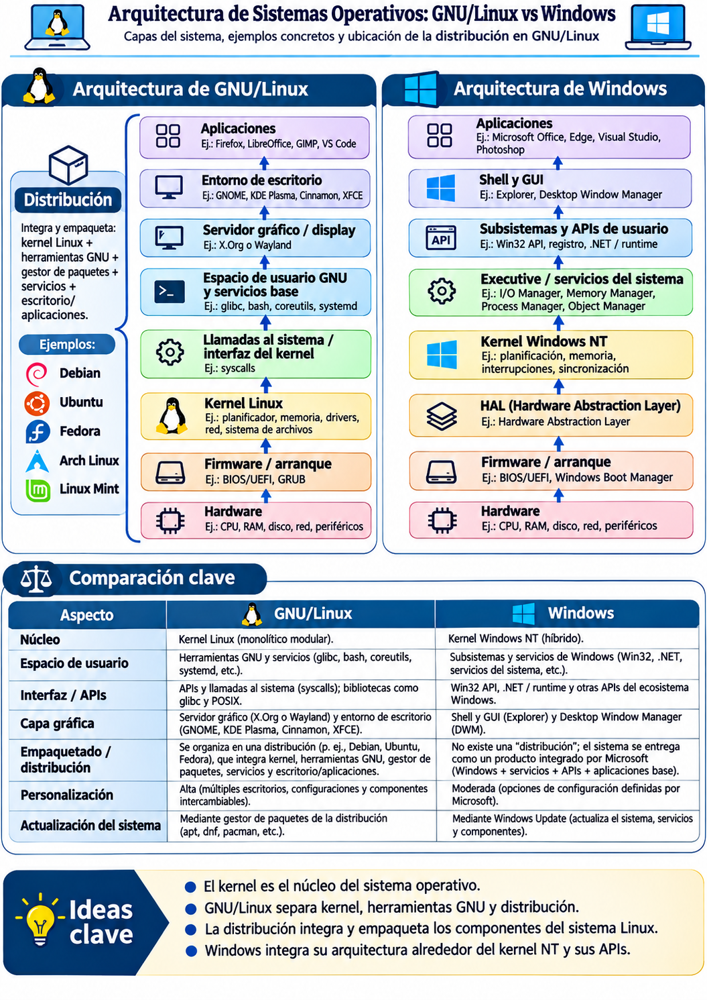

*Ilustración 1. Modelo didáctico comparado de GNU/Linux y Windows. Las flechas representan relaciones funcionales simplificadas, no la secuencia obligatoria de toda instrucción.*

<a id="arquitectura-linux"></a>
## 2. Arquitectura de GNU/Linux

### 2.1 Componentes y responsabilidades

Un sistema GNU/Linux típico combina el **kernel Linux**, bibliotecas, utilidades del espacio de usuario, servicios, herramientas de administración y, opcionalmente, una interfaz gráfica. El kernel permite la gestión de procesos, memoria, archivos, red y controladores. Las utilidades GNU y los programas de terceros permiten administrar el sistema y ejecutar aplicaciones.

| Componente | Responsabilidad | Ejemplos |
|---|---|---|
| Kernel | Planificación, memoria virtual, red, sistema de archivos, controladores. | Kernel Linux, VFS, pila TCP/IP. |
| Bibliotecas y utilidades | Proporcionan interfaces y herramientas de usuario. | glibc, GNU Coreutils (`ls`, `cp`, `mv`), `find`, `grep`. |
| Inicio y servicios | Inicializan y administran procesos de fondo. | `systemd`, `systemctl`, `journald` (según distribución). |
| Shell y terminal | Interpretan órdenes y presentan la interacción. | Bash, Zsh, GNOME Terminal, conexión SSH. |
| Entorno gráfico (opcional) | Ofrece ventanas, paneles y aplicaciones gráficas. | GNOME, KDE Plasma, Xfce; Wayland o X11 según configuración. |
| Aplicaciones | Ejecutan tareas concretas. | `curl`, LibreOffice, Firefox, aplicaciones servidoras. |

**¿Dónde se ubica una distribución?** Una distribución **no es una capa adicional** entre las aplicaciones y el kernel. Es la **integración y entrega de distintas capas y componentes** en una instalación coherente: kernel, gestor de paquetes, bibliotecas, servicios, repositorios y, según la edición, escritorio y aplicaciones. Por ejemplo:

- **Debian / Ubuntu:** generalmente utilizan herramientas de paquetes `apt` y `dpkg`.
- **Fedora / Oracle Linux:** emplean el ecosistema RPM y herramientas como `dnf`.
- **Arch Linux:** utiliza `pacman`.
- **Linux Mint:** suele basarse en Ubuntu; también existe una edición basada directamente en Debian.

Para el taller, la VM OCI puede usar **Oracle Linux o Ubuntu**: los principios del kernel, las rutas de archivos y los comandos de propósito general son semejantes, aunque el gestor de paquetes, el usuario SSH predeterminado y ciertos servicios pueden variar.

<details>
<summary><strong>Contexto histórico: evolución de UNIX, GNU y Linux (infografía previa)</strong></summary>

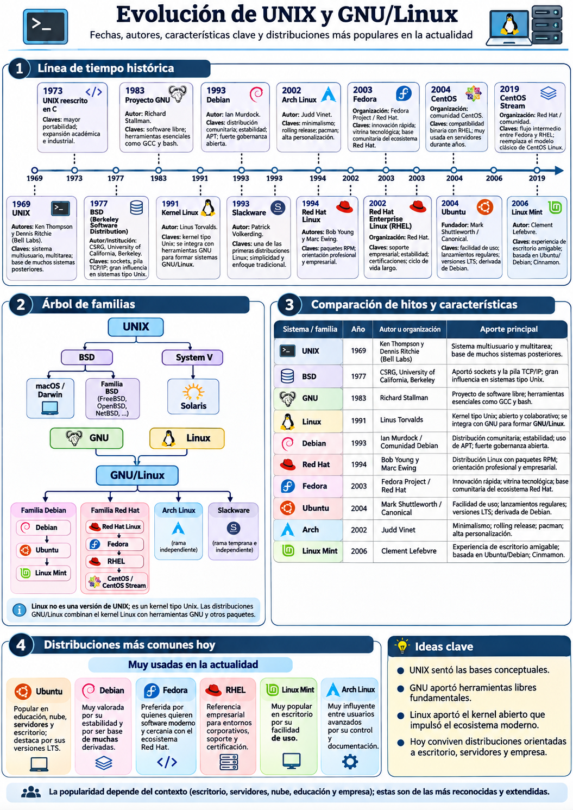

La semejanza entre UNIX y Linux no implica que Linux sea una versión derivada del código fuente de UNIX. Linux es un kernel desarrollado independientemente, de tipo Unix; GNU es un proyecto de software libre iniciado antes del kernel Linux. Además, BSD y macOS tienen trayectorias propias y no son distribuciones de Linux. [Kernel.org](https://kernel.org/linux.html) · [Proyecto GNU](https://www.gnu.org/gnu/gnu-history.html).
</details>

<a id="arquitectura-windows"></a>
## 3. Arquitectura de Windows

Windows moderno, tanto en sus variantes de escritorio como de servidor, pertenece a la **familia Windows NT**. Organiza componentes en **modo usuario** y **modo kernel**. Las aplicaciones consumen APIs y servicios de Windows y, cuando es necesario, realizan operaciones protegidas mediante interfaces del sistema operativo.

| Componente | Responsabilidad | Ejemplos |
|---|---|---|
| Aplicaciones | Ejecución de software de usuario o servidor. | Microsoft Word, Edge, aplicaciones .NET, IIS. |
| Shell y herramientas | Interacción gráfica y administración automatizada. | Explorer, Windows Terminal, PowerShell, CMD. |
| APIs y servicios de usuario | Funciones del sistema, seguridad, servicios, interfaces de programación. | Win32, .NET, Service Control Manager. |
| Subsistemas y componentes del SO | Gestión y coordinación de operaciones protegidas. | Componentes del Executive, administradores de procesos, memoria y E/S. |
| Núcleo Windows NT y controladores | Planificación, interrupciones, sincronización y acceso controlado a hardware. | NT kernel, controladores de almacenamiento y red. |
| Hardware | Recursos físicos. | CPU, RAM, discos, interfaces de red. |

**Comparación conceptual con GNU/Linux:** ambos utilizan aislamiento entre aplicaciones y componentes privilegiados del SO. En Linux, las distribuciones ensamblan numerosas piezas intercambiables; Windows se distribuye como una plataforma integrada desarrollada por Microsoft. **PowerShell no es un kernel** y **Windows Terminal no es lo mismo que PowerShell**: Windows Terminal es una aplicación que aloja sesiones de consola de distintos shells.

<details>
<summary><strong>Evolución histórica: Windows de escritorio</strong></summary>

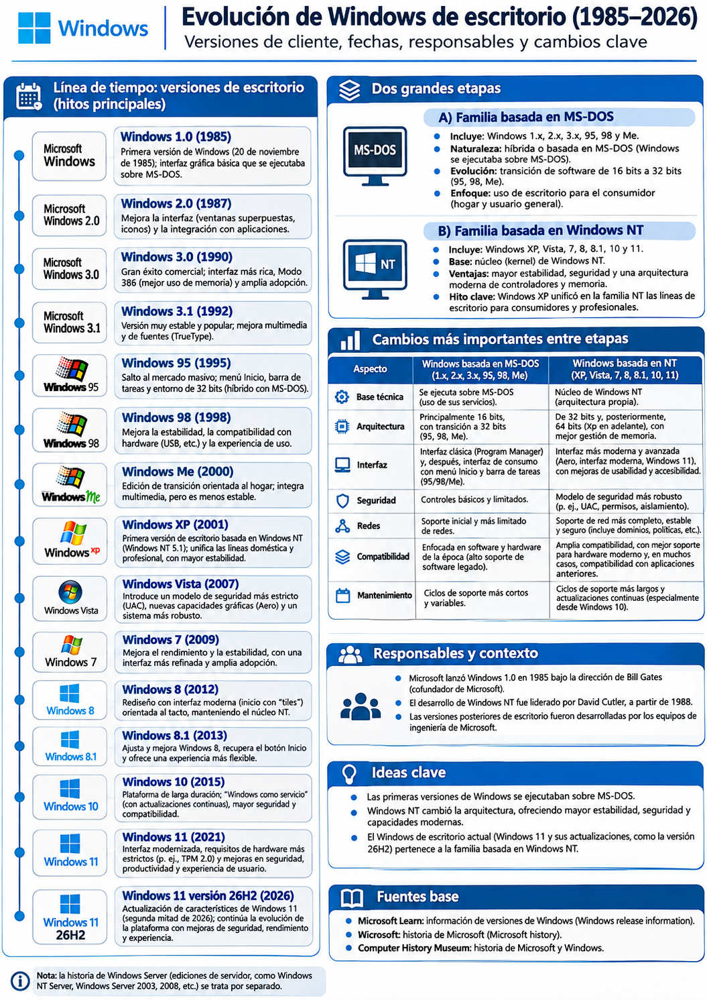

Las antiguas líneas vinculadas a MS-DOS y la línea Windows NT convergieron para el usuario doméstico con Windows XP. La plataforma de Windows 10 y Windows 11 mantiene la arquitectura de la familia NT.
</details>

<details>
<summary><strong>Evolución histórica: Windows Server</strong></summary>

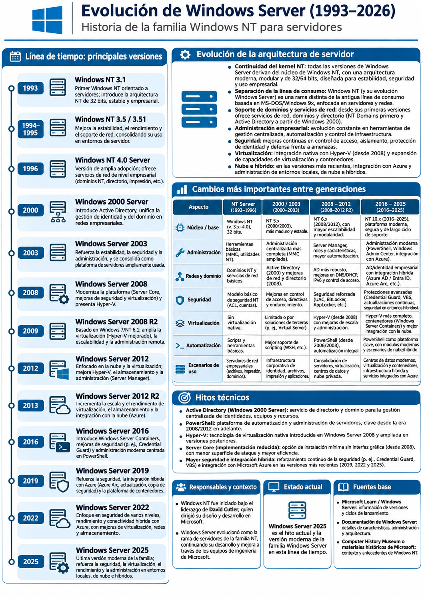

La familia servidor se especializa en servicios de red, autenticación, directorios, virtualización y administración empresarial; comparte la base NT con Windows de escritorio, pero tiene roles y configuraciones de servidor.
</details>

<a id="participacion-mundial"></a>
## 4. Participación mundial de los sistemas operativos según el entorno

La expresión «cuota de mercado» requiere precisar **qué se observó**. No existe un censo único y exhaustivo que reúna móviles, PC, servidores y dispositivos embebidos con idéntico denominador. A continuación se muestran indicadores de fuentes distintas y **no comparables directamente entre entornos**.

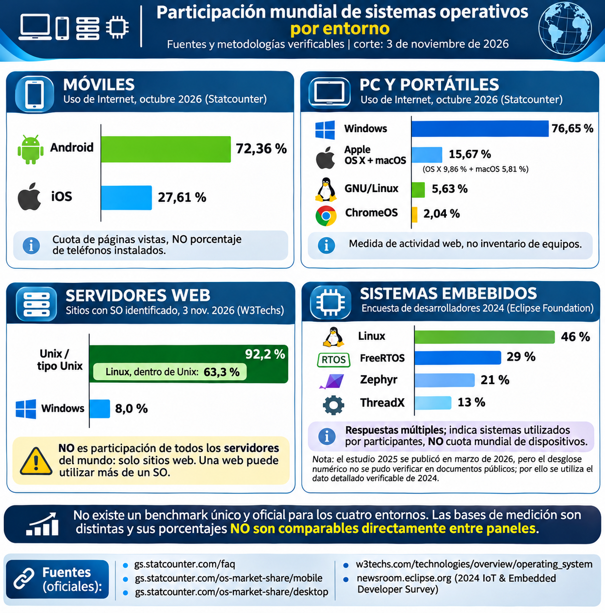

*Ilustración 2. Síntesis de los indicadores publicados previamente. Cada panel tiene un universo estadístico diferente.*

| Entorno | Indicador verificado | Fuente, fecha y alcance |
|---|---|---|
| Móviles | **Android 72,36 %; iOS 27,61 %.** | [Statcounter — móviles](https://gs.statcounter.com/os-market-share/mobile/worldwide), octubre de 2026; proporción de páginas vistas medidas por el servicio. |
| PC y portátiles | **Windows 76,65 %; OS X 9,86 %; macOS 5,81 %; Linux 5,63 %; Chrome OS 2,04 %.** | [Statcounter — escritorio](https://gs.statcounter.com/os-market-share/desktop/worldwide), octubre de 2026; uso web por sistema operativo. Las categorías «OS X» y «macOS» son etiquetas diferenciadas por la fuente. |
| Servidores web | **Unix/tipo Unix 92,2 %; Linux 63,3 %; Windows 8,0 %.** | [W3Techs — comparación de sistemas de los sitios web](https://w3techs.com/technologies/comparison/os-linux,os-unix,os-windows), 3 de noviembre de 2026; solo sitios con SO identificado. **Linux está incluido en Unix/tipo Unix** y un sitio puede usar más de un SO. |
| Sistemas embebidos | **Linux 46 %; FreeRTOS 29 %; Zephyr 21 %; ThreadX 13 %.** | [Eclipse Foundation, encuesta 2024](https://newsroom.eclipse.org/news/announcements/eclipse-foundation-unveils-2024-iot-embedded-developer-survey-results); tecnologías seleccionadas por desarrolladores, **no participación de dispositivos instalados**; respuestas múltiples. |

**Criterios de interpretación:**

- Statcounter estima **uso de Internet mediante páginas vistas**, no porcentaje de equipos físicamente instalados; su metodología se documenta en las [preguntas frecuentes](https://gs.statcounter.com/faq).
- W3Techs observa **sitios web con tecnología identificada**, no el inventario completo de servidores físicos, virtuales o de nube.
- Los resultados de Eclipse son respuestas de una **encuesta de profesionales**; varias tecnologías pueden coexistir en proyectos, por lo que los porcentajes no suman necesariamente 100 %.
- Un dato de «Linux» en servidores web **no puede sumarse** al total «Unix/tipo Unix» porque existe inclusión de categorías.

<a id="shells"></a>
## 5. Arquitectura y flujo de comandos: PowerShell y Bash

Un **shell** recibe instrucciones, evalúa su sintaxis y organiza su ejecución. Un **terminal** presenta la interfaz para escribir órdenes y ver resultados; pueden funcionar por separado. Ni Bash ni PowerShell constituyen el kernel de su sistema anfitrión.

### 5.1 Windows: PowerShell y el flujo de objetos

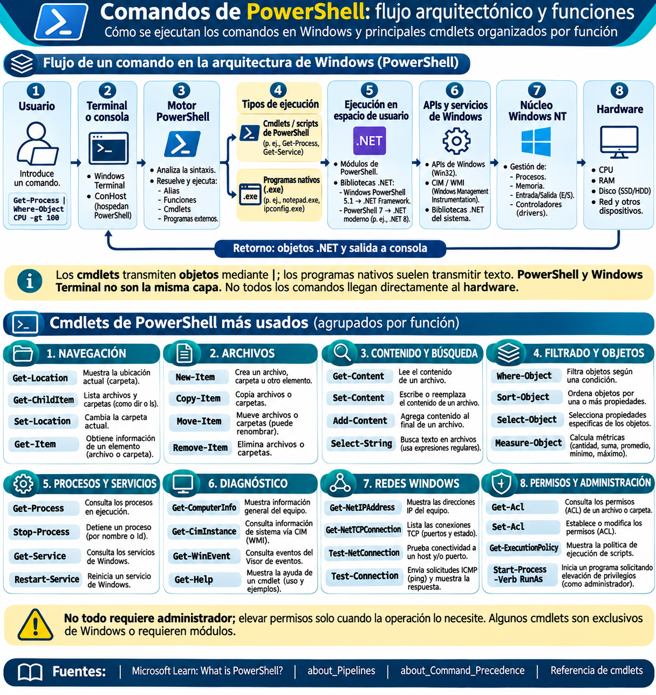

PowerShell integra shell, lenguaje de automatización y herramientas de administración sobre **.NET**. Un *cmdlet* como `Get-Process` produce objetos .NET; el operador `|` permite que el siguiente cmdlet reciba esos objetos y filtre sus propiedades. En cambio, los programas nativos pueden emitir texto. PowerShell también funciona fuera de Windows, aunque varios módulos de administración del SO son específicos de Windows.

```powershell
Get-Process | Sort-Object CPU -Descending | Select-Object -First 5 Name, CPU
```

**Interpretación:** consulta procesos, los ordena según tiempo acumulado de CPU y proyecta cinco registros con las columnas `Name` y `CPU`. Los valores y nombres cambian entre ejecuciones. [Referencia Microsoft Learn](https://learn.microsoft.com/en-us/powershell/scripting/overview) · [Canalizaciones](https://learn.microsoft.com/en-us/powershell/module/microsoft.powershell.core/about/about_pipelines).

### 5.2 GNU/Linux: Bash y el flujo de ejecución

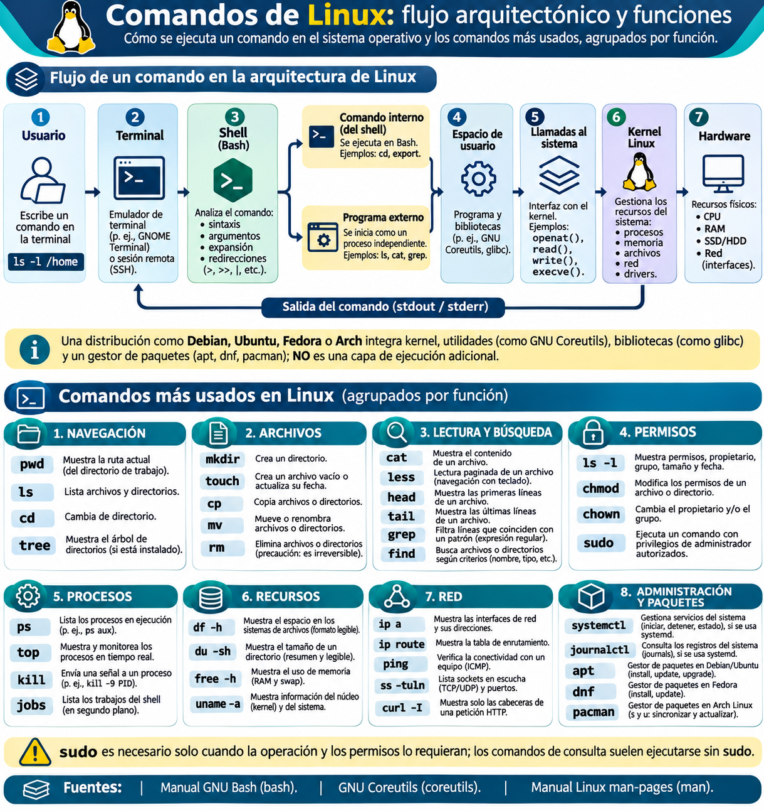

En una sesión Linux típica, el usuario escribe una orden en la terminal; **Bash** realiza el análisis, expansiones y redirecciones; ejecuta directamente las construcciones internas (`cd`, `export`) o inicia programas externos (`ls`, `grep`, `cat`). Si necesitan recursos protegidos, esos procesos utilizan **llamadas al sistema** para interactuar con el kernel; las respuestas llegan a los procesos y se reflejan mediante `stdout` o `stderr`.

```bash
ls -l "$HOME" | grep '^d'
```

**Interpretación:** `ls -l` produce líneas de texto; `grep` filtra las que empiezan por `d`, habituales en el formato de directorio de `ls -l`. Este ejemplo es didáctico y no sustituye una herramienta robusta de inspección de tipos de archivo; el idioma, alias y formato pueden afectar la salida.

> **Diferencia de canalización:** Bash conecta principalmente flujos de bytes/texto entre procesos; PowerShell transmite objetos entre cmdlets. Ninguna de esas diferencias cambia que el control de recursos privilegiados corresponde al kernel y sus interfaces.
>
> **Rutas:** `/home/opc/laboratorio` es **absoluta**; `datos/inventario.csv` es **relativa** al directorio actual. `~` y `$HOME` representan el directorio personal del usuario, no necesariamente `/home/opc`.

Fuentes: [GNU Bash](https://www.gnu.org/software/bash/manual/bash.html), [GNU Coreutils](https://www.gnu.org/software/coreutils/manual/), [Linux kernel](https://docs.kernel.org/) y [Microsoft Learn](https://learn.microsoft.com/en-us/powershell/scripting/overview).

---

<a id="grupos-comandos"></a>
## 6. Ocho grupos de comandos Linux del taller OCI

**Secuencia de aprendizaje:** el reto del grupo *n* utiliza únicamente los comandos, opciones y operadores enseñados en ese grupo o los anteriores. El identificador del estudiante se introduce **por primera vez en el grupo 1** del taller práctico, no en la preparación. Cada reto requiere una captura de pantalla presencial, consolidada con las demás en un único PDF.

**Índice de grupos:** [1. Navegación](#grupo-1) · [2. Archivos](#grupo-2) · [3. Búsqueda](#grupo-3) · [4. Permisos](#grupo-4) · [5. Procesos](#grupo-5) · [6. Recursos](#grupo-6) · [7. Redes y OCI](#grupo-7) · [8. Servicios](#grupo-8)

<a id="grupo-1"></a>
### Grupo 1. Navegación y directorios

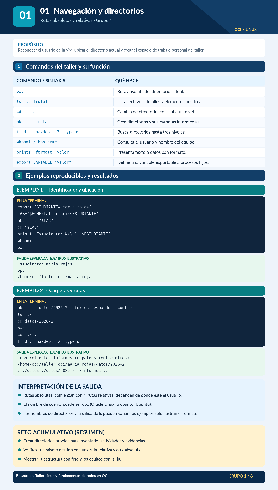

**Objetivo:** comprender el árbol de directorios, localizar el directorio de trabajo y crear rutas personales.

| Comandos | Función |
|---|---|
| `pwd`, `ls -la`, `cd` | Ubicación, listado y navegación. |
| `mkdir -p` | Creación de directorios intermedios. |
| `find ... -type d` | Exploración de directorios. |
| `whoami`, `hostname` | Identidad de sesión y equipo. |
| `printf`, `export` | Presentación de valores y variables del shell. |

**Ejemplo didáctico:**

```bash
pwd
mkdir -p "$HOME/taller_oci/datos/ejemplo"
cd "$HOME/taller_oci"
ls -la
find . -maxdepth 2 -type d
```

**Salida esperada:** `pwd` muestra una ruta absoluta; `find` enumera `.` y los directorios creados hasta la profundidad indicada. El nombre real del directorio personal depende de la VM.

<a id="grupo-2"></a>
### Grupo 2. Creación y administración de archivos

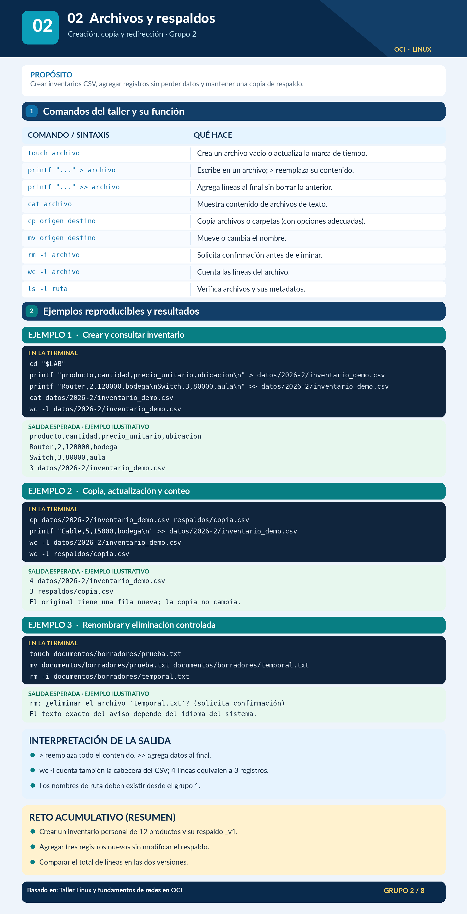

**Objetivo:** elaborar inventarios, copiar respaldos y reconocer operaciones destructivas.

| Comandos / operadores | Función |
|---|---|
| `touch`, `printf`, `>` y `>>` | Crear archivo, escribir, sobrescribir y agregar contenido. |
| `cat`, `wc -l` | Visualizar archivos y contar líneas. |
| `cp`, `mv`, `rm -i` | Copiar, mover/renombrar y borrar con confirmación. |

```bash
printf 'producto,cantidad\nRouter,2\n' > "$HOME/taller_oci/datos/lista.csv"
cat "$HOME/taller_oci/datos/lista.csv"
wc -l "$HOME/taller_oci/datos/lista.csv"
```

**Salida esperada:** se presentan la cabecera y un registro; el conteo es **2 líneas**. El operador `>` reemplaza el archivo de destino si ya existe, por lo que debe usarse exclusivamente sobre archivos de prueba del estudiante.

<a id="grupo-3"></a>
### Grupo 3. Lectura y búsqueda de contenido

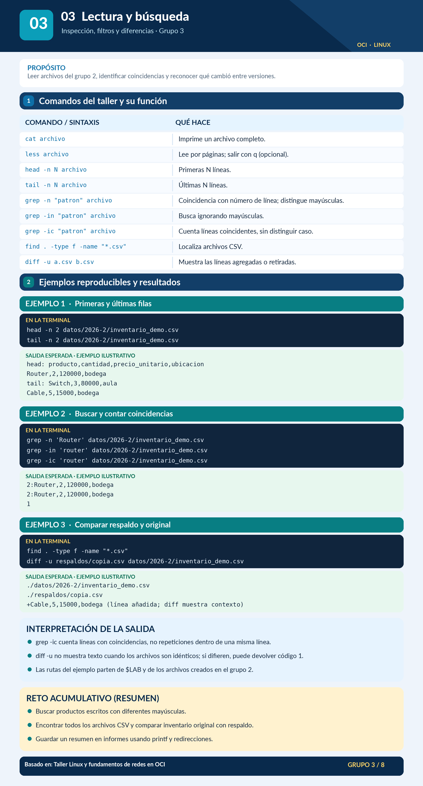

**Objetivo:** seleccionar registros de un inventario, localizar archivos y comprobar diferencias entre versiones.

| Comandos | Función |
|---|---|
| `less`, `head -n`, `tail -n` | Lectura paginada, comienzo y final del archivo. |
| `grep -n`, `grep -in`, `grep -ic` | Buscar con número de línea, ignorar mayúsculas y contar líneas coincidentes. |
| `find ... -type f -name`, `diff -u` | Encontrar archivos y comparar contenido. |

```bash
head -n 2 "$HOME/taller_oci/datos/lista.csv"
grep -in 'router' "$HOME/taller_oci/datos/lista.csv"
```

**Salida esperada:** `head` presenta las dos primeras líneas; `grep` devuelve `2:Router,2`, dado el contenido ilustrativo creado en el grupo anterior. El resultado no aplica si el estudiante modificó el archivo.

<a id="grupo-4"></a>
### Grupo 4. Usuarios, permisos y privilegios

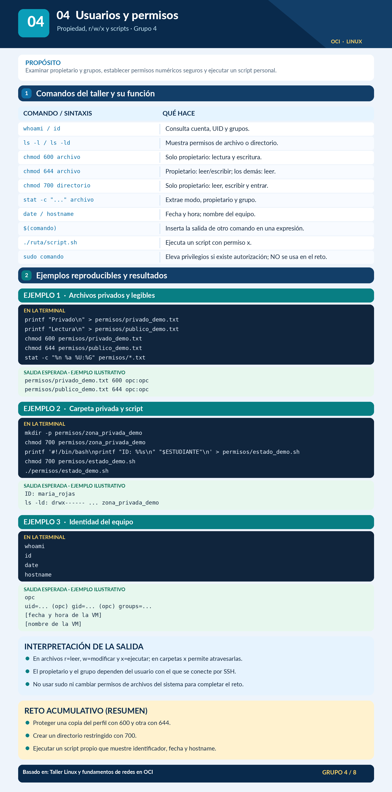

**Objetivo:** interpretar permisos POSIX y limitar el acceso a archivos personales.

| Comandos | Función |
|---|---|
| `whoami`, `id` | Usuario, UID y grupos. |
| `ls -l`, `stat -c` | Permisos simbólicos y numéricos. |
| `chmod` | Cambia permisos de archivos propios. |
| `date`, `hostname`, `sudo` | Hora, equipo y elevación autorizada (sin usar `sudo` en el reto). |

```bash
touch "$HOME/taller_oci/datos/privado.txt"
chmod 600 "$HOME/taller_oci/datos/privado.txt"
stat -c '%n %a %U:%G' "$HOME/taller_oci/datos/privado.txt"
```

**Salida esperada:** nombre de archivo seguido de `600` y usuario:grupo reales. El valor **600** concede lectura/escritura al propietario y ningún permiso al grupo ni a otros; **700** agrega ejecución/acceso al propietario.

<a id="grupo-5"></a>
### Grupo 5. Procesos y trabajos del shell

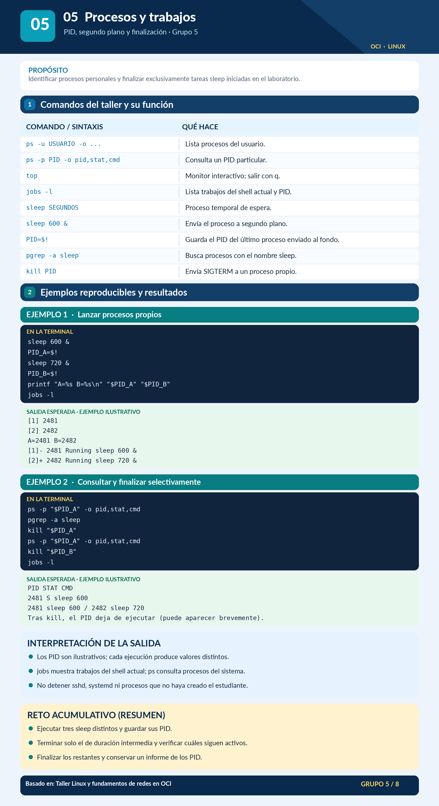

**Objetivo:** reconocer PID, estado de procesos, ejecución en segundo plano y terminación controlada.

| Comandos y operadores | Función |
|---|---|
| `ps`, `top`, `pgrep -a` | Consultar y monitorear procesos. |
| `sleep`, `&`, `$!`, `jobs -l` | Crear y reconocer un trabajo en segundo plano. |
| `kill PID` | Solicitar la terminación de un proceso propio. |

```bash
sleep 120 &
PID=$!
ps -p "$PID" -o pid,stat,cmd
jobs -l
kill "$PID"
```

**Salida esperada:** `ps` identifica un proceso `sleep 120` con un PID variable; `jobs` refleja el trabajo del shell que lo creó. `kill` actúa únicamente sobre el proceso de prueba registrado en `$PID`.

<a id="grupo-6"></a>
### Grupo 6. Recursos del sistema

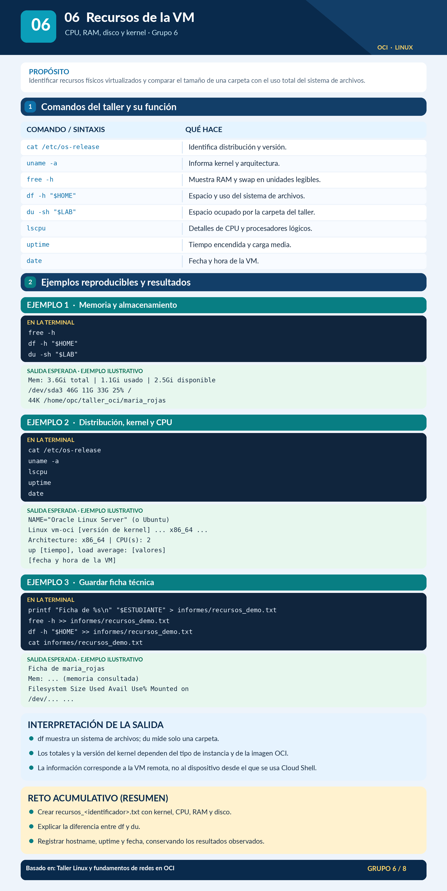

**Objetivo:** obtener datos de la VM sin confundir el tamaño del archivo, el espacio libre o la memoria física.

| Comandos | Función |
|---|---|
| `uname -a` | Identifica kernel y plataforma. |
| `free -h` | Reporta RAM y swap. |
| `df -h`, `du -sh` | Capacidad del sistema de archivos y tamaño de un directorio. |
| `lscpu`, `uptime`, `cat /etc/os-release` | CPU, tiempo de actividad y distribución. |

```bash
uname -a
free -h
df -h "$HOME"
du -sh "$HOME/taller_oci"
cat /etc/os-release
```

**Salida esperada:** valores de CPU, memoria y disco propios de la instancia. `df` y `du` **no son equivalentes**: el primero informa el uso del sistema de archivos y el segundo, el espacio ocupado por una ruta.

<a id="grupo-7"></a>
### Grupo 7. Redes, conectividad y recursos de OCI

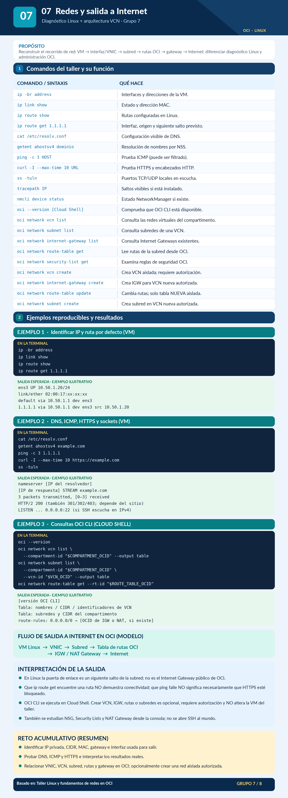

**Objetivo:** diferenciar la pila de red del SO de la infraestructura virtual de OCI, e interpretar por qué la VM puede o no alcanzar Internet.

**A. Dentro de la VM Linux:**

| Comandos | Interpretación |
|---|---|
| `ip -br address`, `ip link show` | Interfaces, IP, estado de enlace y MAC. |
| `ip route show`, `ip route get IP` | Ruta por defecto y selección de ruta hacia el destino. |
| `cat /etc/resolv.conf`, `getent ahostsv4 DOMINIO` | Configuración de resolución DNS y nombres resueltos. |
| `ping -c 3`, `curl -I --max-time 10` | Prueba ICMP y acceso a servicio HTTP(S), respectivamente. |
| `ss -tuln` | Puertos TCP/UDP locales en escucha. |
| `tracepath`, `nmcli device status` | Herramientas opcionales; pueden no estar instaladas. |

```bash
ip -br address
ip route show
ip route get 1.1.1.1
getent ahostsv4 example.com
curl -I --max-time 10 https://example.com
ss -tuln
```

**Salida esperada:** nombres de interfaz como `ens3` (no garantizado), IP privadas del rango asignado a la subred, una ruta `default via ...` si está configurada y encabezados HTTP si DNS, rutas, controles de seguridad y salida a Internet permiten el acceso. `curl` puede fallar por un problema de DNS, TLS, ruta o filtrado; `ping` fallido **no prueba por sí solo** la ausencia de conectividad.

**B. En la infraestructura OCI (consultar en consola o OCI CLI):**

**Ruta conceptual:** VM → VNIC → subred/VCN → tabla de rutas de OCI → destino del siguiente salto (Internet Gateway para salida pública con IP pública, o NAT Gateway para salida desde subred privada) → Internet. Las reglas de seguridad (NSG o listas), políticas IAM y la configuración del SO deben ser coherentes. Las rutas observadas con `ip route` **no muestran directamente** las reglas completas de la tabla de rutas de OCI.

| Recurso | Uso |
|---|---|
| VCN y subred | Segmentación y direccionamiento de red privada virtual. |
| VNIC e IP privada | Interfaz y dirección de la instancia en la VCN. |
| Internet Gateway | Entrada/salida conforme a rutas, IP pública y reglas aplicables. |
| NAT Gateway | Salida hacia Internet sin asignar IP pública a la VM; no permite conexiones iniciadas desde Internet. |
| Tabla de rutas de OCI | Define el siguiente salto hacia un CIDR de destino. |
| NSG / Security List | Filtra tráfico de entrada y salida. |

```bash
# Ejemplos de consulta: ejecutar en OCI Cloud Shell, no dentro de la VM
oci --version
oci network vcn list --compartment-id "$COMPARTMENT_OCID"
oci network subnet list --compartment-id "$COMPARTMENT_OCID" --vcn-id "$VCN_OCID"
```

**Requisitos:** declarar variables con OCID válidos y disponer de permisos IAM. La **creación** de VCN, subredes, gateways o cambios a reglas de red se reserva a los ejercicios opcionales autorizados del taller práctico; no es necesaria para entender el flujo. Evitar modificar la red de la VM de clase.

<a id="grupo-8"></a>
### Grupo 8. Servicios, registros y paquetes

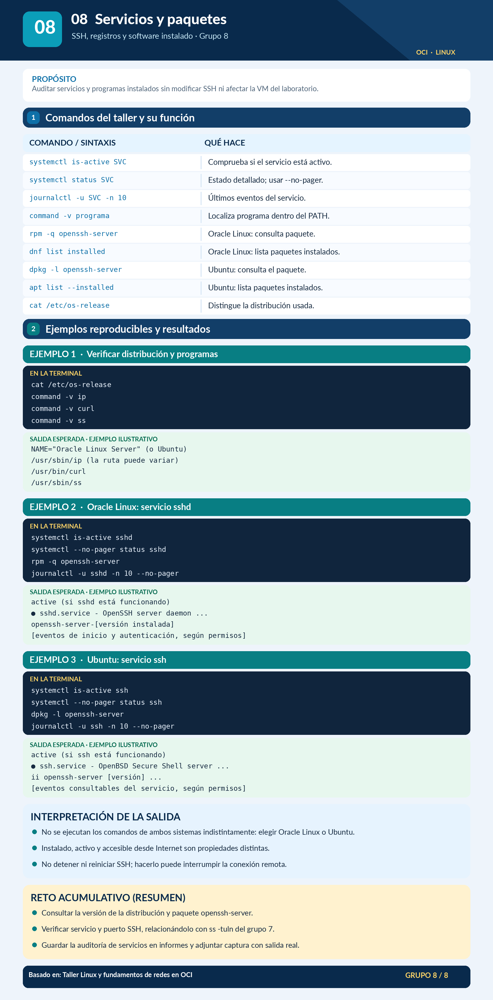

**Objetivo:** leer el estado de servicios y registros, identificar programas instalados y reconocer diferencias entre distribuciones.

| Comandos | Función |
|---|---|
| `systemctl is-active`, `systemctl status` | Consultar servicios bajo `systemd`. |
| `journalctl -u ... -n 10 --no-pager` | Revisar eventos asociados con una unidad. |
| `command -v` | Verificar si hay un ejecutable accesible mediante `PATH`. |
| `rpm -q`, `dnf list installed` | Consultar paquetes en Oracle Linux. |
| `dpkg -l`, `apt list --installed` | Consultar paquetes en Ubuntu. |

```bash
systemctl is-active sshd   # Frecuente en Oracle Linux
systemctl is-active ssh    # Frecuente en Ubuntu
command -v curl
```

**Salida esperada:** para el servicio presente, un estado como `active`, `inactive` o `failed`; si la unidad no existe puede aparecer `unknown`. El servicio SSH puede llamarse `sshd` o `ssh` según la distribución. Los comandos anteriores **consultan**, no cambian el estado del servicio.

---

<a id="referencias"></a>
## 7. Fuentes técnicas y criterios de interpretación

### Arquitectura de sistemas operativos

1. Linux Kernel Organization. [Documentación oficial del kernel Linux](https://docs.kernel.org/).
2. Kernel.org. [What is Linux?](https://kernel.org/linux.html).
3. GNU Project. [GNU History](https://www.gnu.org/gnu/gnu-history.html).
4. Microsoft Learn. [Modo de usuario y modo kernel](https://learn.microsoft.com/es-es/windows-hardware/drivers/gettingstarted/user-mode-and-kernel-mode).
5. Microsoft Learn. [Tipos de controladores de Windows](https://learn.microsoft.com/en-us/windows-hardware/drivers/kernel/types-of-windows-drivers).

### Shell, comandos y administración

6. GNU Project. [Bash Reference Manual](https://www.gnu.org/software/bash/manual/bash.html).
7. GNU Project. [GNU Coreutils Manual](https://www.gnu.org/software/coreutils/manual/).
8. Microsoft Learn. [Qué es PowerShell](https://learn.microsoft.com/en-us/powershell/scripting/overview).
9. Microsoft Learn. [PowerShell pipelines](https://learn.microsoft.com/en-us/powershell/module/microsoft.powershell.core/about/about_pipelines).
10. Oracle. [Crear una instancia Compute](https://docs.oracle.com/en-us/iaas/Content/Compute/Tasks/launchinginstance.htm).
11. Oracle. [Documentación de Oracle Cloud Networking](https://docs.oracle.com/en-us/iaas/Content/Network/Concepts/overview.htm).

### Participación y metodología

12. Statcounter Global Stats. [SO móviles](https://gs.statcounter.com/os-market-share/mobile/worldwide); [SO escritorio](https://gs.statcounter.com/os-market-share/desktop/worldwide); [metodología](https://gs.statcounter.com/faq). Datos de octubre de 2026.
13. W3Techs. [Uso de sistemas operativos en sitios web](https://w3techs.com/technologies/comparison/os-linux,os-unix,os-windows). Datos del 3 de noviembre de 2026.
14. Eclipse Foundation. [2024 IoT & Embedded Developer Survey](https://newsroom.eclipse.org/news/announcements/eclipse-foundation-unveils-2024-iot-embedded-developer-survey-results). Encuesta, no inventario mundial de dispositivos.

**Nota sobre la evidencia visual:** las infografías son apoyos pedagógicos preexistentes. Ante una simplificación o discrepancia gráfica, prevalecen la terminología, las precisiones metodológicas de este texto y las fuentes primarias enlazadas. Las estadísticas están fechadas y **no deben extrapolarse a períodos posteriores** sin actualización de la fuente.
