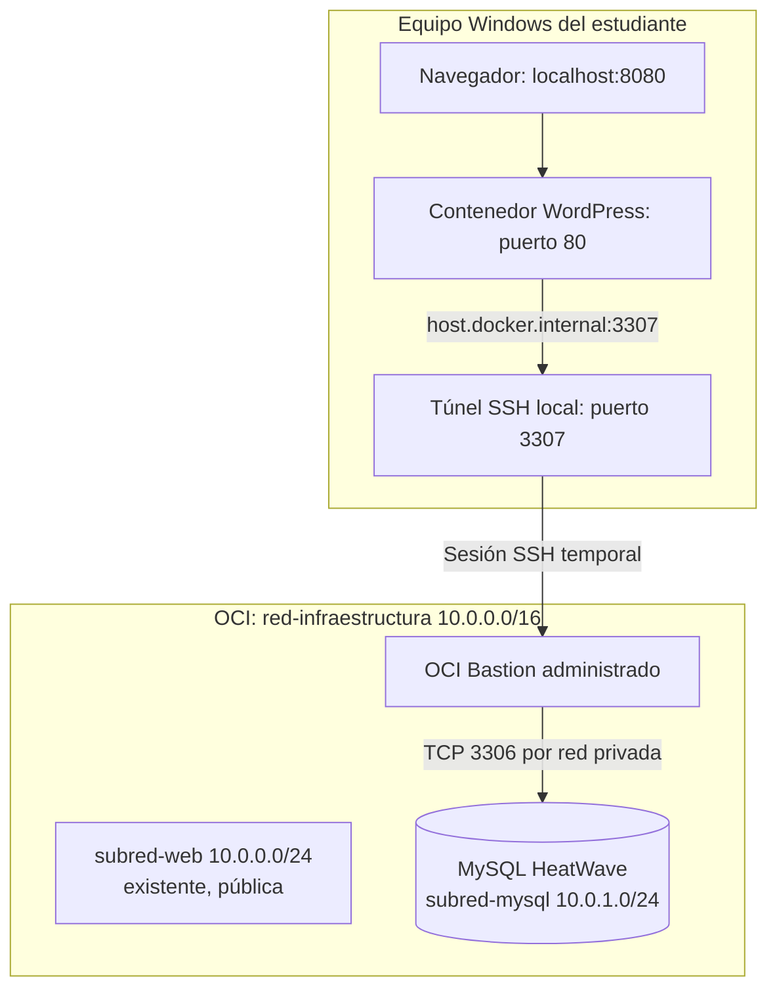

# Taller 7A. Infraestructura cloud: WordPress en Docker Desktop con MySQL HeatWave privado y OCI Bastion

**Asignatura:** Infraestructura y Cloud / Cloud Computing  
**Duración objetivo:** 120 minutos de práctica guiada con recursos preaprovisionados; crear MySQL HeatWave desde cero puede exceder las dos horas.  
**Entorno:** Windows + PowerShell + Docker Desktop + OCI.  
**Prerrequisito:** [Taller 1. Cuenta y red de Infraestructura y Cloud](https://github.com/adanbeltran/Labs/blob/main/Lab-Despliegue%20Web%20IaaS%20con%20OCI%20Compute/Taller_1_Cuenta_y_Red_Infraestructura_Cloud.md).

## Propósito y resultados de aprendizaje

Implementar una arquitectura híbrida de laboratorio: aplicación WordPress en un contenedor local y base MySQL HeatWave administrada en una **subred privada de OCI**, accesible mediante **OCI Bastion administrado y una sesión temporal de reenvío de puertos SSH**. Al terminar, el estudiante podrá explicar los límites de confianza, la segmentación de red, las políticas IAM, el flujo TCP, la persistencia de datos y las diferencias entre un bastión tradicional, un bastión administrado y un enfoque Zero Trust.

**Alcance:** laboratorio educativo, no despliegue de producción. No se crea una VM bastión, no se asigna IP pública a MySQL y no se abre TCP 3306 a Internet. El túnel SSH es **temporal**: no es un mecanismo de conexión permanente para WordPress productivo. Para el futuro taller de WordPress en OCI Container Instances, la aplicación debe conectarse por red privada a MySQL sin pasar por el túnel del estudiante.

## Arquitectura y flujo de comunicación



**Lectura de la arquitectura:** el navegador accede al WordPress local; WordPress envía SQL hacia `host.docker.internal:3307`; el host Windows reenvía la conexión a OCI Bastion mediante SSH; Bastion conecta con la IP privada de MySQL, puerto 3306. **OCI Bastion no es una VM Linux del estudiante y no requiere que el servidor MySQL ejecute SSH.** El reenvío SSH cifra el tramo hasta Bastion; el uso de TLS propio de MySQL se evalúa por separado si la política de la cuenta lo exige.

### Recursos existentes: no recrear

| Recurso del Taller 1 | Valor |
|---|---|
| Compartimento | `Infraestructura_y_Cloud` |
| Dominio, grupo y usuario | `Default`, `GrupoInfraestructura`, `estudiante-web` |
| Política | `PermisosInfraestructura` |
| VCN | `red-infraestructura`, `10.0.0.0/16` |
| Subred pública | `subred-web`, `10.0.0.0/24` |
| Internet Gateway | `salida-internet` |
| Rutas y lista de seguridad públicas | Conservar configuración del Taller 1; no añadir reglas públicas para MySQL |

**Recursos nuevos:** `subred-mysql` privada (`10.0.1.0/24`), lista de seguridad `seguridad-mysql`, MySQL DB System `wordpress-mysql`, OCI Bastion `BastionWordpress`, sesión temporal de port forwarding y volumen/contenedor Docker. Si ya existen de un intento anterior, **verificarlos y reutilizarlos**.

### Plan de trabajo

| Fase | Actividad | Tiempo orientativo |
|---|---|---:|
| 1 | Validación de infraestructura, IAM y segmentación privada | 25 min |
| 2 | MySQL HeatWave, Bastion y túnel SSH | 45 min* |
| 3 | WordPress en Docker Desktop | 30 min |
| 4 | Modelo de datos, persistencia y análisis de seguridad | 20 min |
| **Total** | | **120 min** |

*Para cumplir el tiempo, el docente debe preaprovisionar MySQL HeatWave y verificar cuotas, permisos y disponibilidad regional. Si cada estudiante debe esperar la creación del DB System desde cero, el taller puede durar más de dos horas.*

---

## Fase 1. Reutilizar la red y completar el aislamiento de MySQL (25 minutos)

### Paso 1.1. Comprobar los recursos previos

1. Ingresar a [OCI Console](https://cloud.oracle.com/) como `estudiante-web`, en la **misma región** del Taller 1.
2. En **Networking → Virtual Cloud Networks**, seleccionar `Infraestructura_y_Cloud` y abrir `red-infraestructura`.
3. Verificar CIDR `10.0.0.0/16`, subred `subred-web` (`10.0.0.0/24`), Internet Gateway `salida-internet` y tabla de rutas de la subred pública.
4. Revisar `datos-taller.txt` del Taller 1. No modificar las reglas de los servicios web existentes.

**Evidencia:** registro de la VCN y las subredes, sin información sensible.

### Paso 1.2. Ampliar los permisos IAM existentes

La política del Taller 1 habilita red y Compute, pero no administra MySQL ni Bastion. Con la **cuenta administradora**, abrir la política `PermisosInfraestructura` y **añadir**, sin borrar las líneas anteriores:

```text
Allow group 'Default'/'GrupoInfraestructura' to manage mysql-family in compartment Infraestructura_y_Cloud
Allow group 'Default'/'GrupoInfraestructura' to manage bastion-family in compartment Infraestructura_y_Cloud
```

1. Guardar la política; si el dominio IAM no es `Default`, usar su nombre real.
2. Volver a iniciar sesión como `estudiante-web` y comprobar acceso a **MySQL HeatWave → DB Systems** y **Bastion**.
3. Si una acción no está autorizada, solicitar al docente que revise los permisos. **No asignar privilegios Administrators** para resolver el problema.

**Concepto:** IAM autoriza acciones sobre recursos; una regla de seguridad de red autoriza tráfico. Son controles diferentes y complementarios.

### Paso 1.3. Crear la lista de seguridad de la base de datos

1. En `red-infraestructura`, abrir **Security → Security Lists → Create Security List**.
2. Nombre `seguridad-mysql`, compartimento `Infraestructura_y_Cloud`.
3. Crear regla **stateful** de ingreso TCP al puerto destino `3306`, **solo desde el rango privado que efectivamente use OCI Bastion para alcanzar la subred**. Para esta práctica se puede empezar con `10.0.1.0/24` y restringir después al origen más específico documentado/observado. **No** utilizar `0.0.0.0/0`.
4. Conservar las reglas de egreso mínimas necesarias. La respuesta a una conexión stateful permitida no exige abrir un ingreso general adicional.
5. Guardar la lista.

**Comprobación:** ninguna regla de ingreso pública permite el puerto 3306. La lista de seguridad de `subred-web` no se modifica.

### Paso 1.4. Crear la subred privada

1. Abrir `red-infraestructura → Subnets → Create Subnet`.
2. Configurar:

| Campo | Valor |
|---|---|
| Nombre | `subred-mysql` |
| Compartimento | `Infraestructura_y_Cloud` |
| Tipo | Regional |
| CIDR IPv4 | `10.0.1.0/24` |
| Acceso | **Private Subnet** |
| Security List | `seguridad-mysql` |
| Tabla de rutas | Crear/seleccionar tabla **sin** ruta `0.0.0.0/0` hacia `salida-internet` |
| DNS | Habilitar nombres internos si lo solicita el servicio |

3. Verificar que no se superponga con `subred-web`.
4. Crear la subred y confirmar su estado y carácter privado.

**Resultado:** una sola VCN, una subred pública existente y una subred privada nueva. La ausencia de IP pública y las reglas de red son parte del aislamiento; la etiqueta «privada» por sí sola no reemplaza una revisión de rutas y políticas.

---

## Fase 2. Crear MySQL HeatWave y acceder mediante OCI Bastion (45 minutos)

### Paso 2.1. Crear MySQL HeatWave en OCI

La opción **Create DB system** contiene las secciones *Template*, *Provide DB system information*, *Create administrator credentials*, *Setup*, *Configure networking*, *Configure placement*, *Configure hardware*, *Configure backup plan*, *Tools*, *Provide contacts* y *Advanced options*. Las opciones pueden variar según región, permisos y modalidad de cuenta. **No pulsar Create DB system hasta completar todas las comprobaciones.**

**2.1.1. Acceder al servicio y verificar los prerrequisitos**

1. Abrir **MySQL HeatWave → DB systems** en la región principal de OCI.
2. En **Applied filters**, seleccionar `Infraestructura_y_Cloud` y verificar que la lista está vacía o identificar si ya existe `wordpress-mysql` para evitar duplicados.
3. Si aparece **Prerequisites: The compartment is empty**, abrir **View details**. Comprobar los permisos IAM, la VCN, la subred privada y la disponibilidad/cuota del servicio. Este aviso no significa que deba recrearse la VCN.
4. Observar el aviso de fin de vida de **MySQL 8.0**: las nuevas instancias deben utilizar la versión compatible propuesta por OCI, normalmente MySQL 8.4 LTS; no seleccionar versiones retiradas.
5. Pulsar **Create DB system**.

**2.1.2. Seleccionar Template**

| Campo visible | Selección para el laboratorio | Verificación |
|---|---|---|
| Template | **Always Free** | Solo si la cuenta/región muestra elegibilidad real |
| Production | **No seleccionar** | No requiere alta disponibilidad |
| Development or testing | Alternativa **solo con autorización de costo** | Puede ser facturable |

Seleccionar la plantilla **Always Free**. No confundir esta plantilla con el crédito promocional de Oracle Academy: comprobar siempre el costo final antes de crear.

**2.1.3. Provide DB system information**

| Campo | Valor |
|---|---|
| Create in compartment | `Infraestructura_y_Cloud` |
| Name | `wordpress-mysql` |
| Description | `MySQL privado para WordPress en Docker Desktop y OCI` |

**2.1.4. Create administrator credentials**

1. En **Username**, escribir `adminwp` (o un nombre admitido por el formulario).
2. En **Password** y **Confirm password**, utilizar una contraseña robusta y distinta de las credenciales de OCI y WordPress.
3. Guardar la contraseña en un gestor seguro. **No incluirla en las evidencias, GitHub ni `datos-taller.txt`.**
4. Este usuario administra MySQL; **no** es el usuario administrador del sitio WordPress.

**2.1.5. Setup**

Seleccionar **Standalone**. La opción **High availability** aparece deshabilitada en la plantilla Always Free y no es necesaria para el laboratorio. La ausencia de alta disponibilidad implica que una falla de la instancia puede interrumpir el servicio.

**2.1.6. Configure networking (sección crítica)**

| Campo de la pantalla | Valor requerido |
|---|---|
| Virtual cloud network compartment | `Infraestructura_y_Cloud` |
| Virtual cloud network | `red-infraestructura` |
| Subnet compartment | `Infraestructura_y_Cloud` |
| Subnet | `subred-mysql` **privada**, `10.0.1.0/24` |
| Network security groups (NSGs) | Dejar vacío si se utiliza la Security List `seguridad-mysql`; si se usa un NSG, configurar su regla TCP 3306 correctamente |

1. **No seleccionar `subred-web`**, aunque ya exista: es pública y se reservó para servidores web.
2. Si `subred-mysql` no aparece en el desplegable, volver al paso 1.4, verificar que pertenece a la misma VCN, región y compartimento y que está disponible.
3. Verificar que la regla de ingreso TCP **3306** autoriza el origen privado correspondiente a OCI Bastion, no `0.0.0.0/0`.
4. El formulario indica que el endpoint MySQL tendrá **IP privada y no será directamente accesible desde Internet**. Ese es el comportamiento esperado.

**2.1.7. Configure placement**

En **Availability domain**, conservar el dominio propuesto por OCI (por ejemplo, AD-1). Conservar el dominio de disponibilidad propuesto por OCI; no intentar cambiarlo si la plantilla Always Free no ofrece otra opción.

**2.1.8. Configure hardware**

| Campo visible | Valor para la práctica |
|---|---|
| Enable HeatWave cluster | **Desactivado** |
| Shape | `MySQL.Free` con indicación **Always Free-eligible** |
| ECPU count | `1`, si corresponde a la configuración MySQL.Free mostrada por OCI |
| Memory size | `8 GiB`, si corresponde a la configuración MySQL.Free mostrada por OCI |
| Max network bandwidth | `1 Gbps`, si corresponde a la configuración MySQL.Free mostrada por OCI |
| Initial data storage size | `50 GiB`, si corresponde a la configuración MySQL.Free mostrada por OCI |

Los valores mostrados son los de la consola aportada, no una promesa de capacidad en cualquier región o cuenta. **No pulsar Change shape** ni habilitar el clúster HeatWave para este laboratorio. Los valores IOPS/throughput son informativos y no requieren cambios.

**2.1.9. Configure backup plan y Cross-region copy**

1. **Enable automatic backups:** conservar el valor predeterminado desactivado de la plantilla Always Free, si así lo establece la plantilla seleccionada. Si se habilita en otra modalidad, comprobar costos y cuotas.
2. **Backup retention period**, **Enable point-in-time recovery**, **Select backup window** y **Soft delete**: conservar sus valores predeterminados/deshabilitados cuando el formulario los presente inactivos.
3. **Cross-region copy:** desactivado. No es necesario replicar copias a otra región.
4. **Concepto de infraestructura:** una base persistente **no equivale** a una estrategia de respaldo. El laboratorio demuestra persistencia frente a recreación de contenedores, no recuperación ante pérdida de la base.

**2.1.10. Tools y contactos**

1. En **Tools → MySQL Studio**, conservar **desactivado**: las consultas se harán desde MySQL Workbench mediante OCI Bastion.
2. En **Provide contacts for operational notifications and announcements**, introducir un correo válido si el formulario lo exige, o utilizar **Add current user email**. Esta dirección recibirá notificaciones operativas; no se utiliza para conectarse a la base.

**2.1.11. Advanced options y protección contra eliminación**

1. Abrir **Advanced options**. Las secciones visibles son **Deletion plan**, **Configuration**, **Manage encryption key**, **Connections**, **Crash recovery**, **Maintenance**, **Management**, **Data import**, **Security attributes**, **Logs** y **Tags**.
2. En **Deletion plan**, conservar **Delete protected** activado si el DB System se reutilizará en el siguiente taller. Esto evita eliminaciones accidentales.
3. **Automatic backup retention**: conservar la opción predeterminada que muestre la plantilla y comprobar qué implica al eliminar el sistema; no habilitar opciones adicionales con costo sin autorización.
4. **Final backup**: dejar desactivado para la práctica, salvo instrucción expresa del docente.
5. Mantener el resto de **Advanced options** en sus valores predeterminados. No crear claves de cifrado administradas por el cliente ni cambiar configuraciones de mantenimiento o conexiones sin necesidad.
6. Revisar **resumen de configuración y costos**, verificar que aparece **Always Free-eligible**, que no se añadieron servicios facturables y que la red es privada.
7. Pulsar **Create DB system** una sola vez y esperar hasta que el estado sea **ACTIVE**. El aprovisionamiento puede tardar y no se garantiza que termine dentro de los 45 minutos de esta fase.

**2.1.12. Registrar el endpoint para el túnel**

1. Abrir el DB System creado y localizar **Endpoints**.
2. Anotar en el archivo de trabajo **únicamente** la IP privada de MySQL y el puerto TCP `3306` (sin contraseñas).
3. Confirmar que no se asignó IP pública y que la subred indicada es `subred-mysql`.
4. No ejecutar todavía WordPress: continuar con la creación de OCI Bastion y comprobar la conectividad desde Windows y Docker.

**Evidencias:** plantilla Always Free, configuración de red privada, shape `MySQL.Free`, estado ACTIVE y endpoint privado. Ocultar credenciales y datos sensibles.

### Paso 2.2. Crear un bastión **administrado**, no una VM de salto

1. Abrir **Identity & Security → Bastion → Create Bastion** en `Infraestructura_y_Cloud`.
2. Configurar `BastionWordpress`, VCN `red-infraestructura` y **Target Subnet** `subred-mysql`.
3. En **CIDR allowlist**, registrar la **IP pública actual del estudiante con máscara `/32`**, por ejemplo `198.51.100.7/32` (dirección ilustrativa, no usarla literalmente).
4. Crear y comprobar que el servicio quede disponible.

**Seguridad:** no se crea un servidor Linux/Windows con SSH público. OCI administra el punto de acceso. La allowlist limita desde qué IP pública se acepta la sesión; la llave SSH y los permisos IAM aportan controles adicionales. Esto **no equivale por sí solo a una implementación integral Zero Trust**.

### Paso 2.3. Crear llave SSH y sesión temporal de port forwarding

1. Abrir PowerShell:

```powershell
New-Item -ItemType Directory -Force "$HOME\.ssh" | Out-Null
ssh-keygen -t ed25519 -f "$HOME\.ssh\lab7a_bastion" -C "lab7a-wordpress"
Get-Content "$HOME\.ssh\lab7a_bastion.pub"
```

2. Conservar la **llave privada** en Windows; copiar **solo la llave pública**.
3. En `BastionWordpress → Sessions → Create Session`, seleccionar **SSH Port Forwarding Session**.
4. Especificar la IP **privada** del endpoint de MySQL, puerto **3306**, llave pública y una duración suficiente para la práctica (dentro del máximo que permita la consola).
5. Crear la sesión y usar **Copy SSH command**. **El comando generado por OCI es la referencia autoritativa**: contiene identificadores de sesión, hostname y puerto reales. No inventar estos valores.
6. Adaptar únicamente la ruta de la llave privada y el **puerto local 3307**. El patrón general de la parte local es `-L DIRECCION_LOCAL:3307:IP_PRIVADA_MYSQL:3306`.

**Importante para Docker Desktop:** un túnel ligado únicamente a `127.0.0.1` de Windows puede no ser accesible desde `host.docker.internal` en el contenedor. Tampoco se debe utilizar indiscriminadamente `-L 0.0.0.0:3307:...`, porque puede exponer el reenvío a otras interfaces del equipo. Para la práctica, el docente debe validar previamente una de estas opciones:

- **Opción preferente:** enlazar el túnel solo a la interfaz de host accesible desde Docker Desktop y restringir el firewall de Windows a la red/interfaz Docker.
- **Opción alternativa controlada:** permitir temporalmente el enlace en `0.0.0.0:3307` **solo si** una regla explícita del firewall bloquea conexiones de redes no autorizadas y se comprueba que el puerto no es accesible desde la LAN o Internet.

No usar una solución que abra MySQL públicamente. El túnel debe mantenerse abierto mientras WordPress accede a la base de datos y cerrarse al terminar. **El laboratorio no presupone que `host.docker.internal` funcione sin verificarlo.**

### Paso 2.4. Probar conectividad desde Windows **y desde Docker**

1. En otra ventana PowerShell, verificar que el túnel responde en la dirección de escucha elegida:

```powershell
Test-NetConnection 127.0.0.1 -Port 3307
```

2. En **MySQL Workbench**, crear conexión TCP/IP a `127.0.0.1`, puerto `3307`, usuario administrador de MySQL y contraseña correspondiente. Si el túnel está ligado a otra interfaz, adaptar el host de Workbench.
3. Ejecutar:

```sql
CREATE DATABASE IF NOT EXISTS wordpressdb
  CHARACTER SET utf8mb4
  COLLATE utf8mb4_unicode_ci;
SHOW DATABASES;
SELECT VERSION() AS version_mysql;
SELECT COUNT(*) AS tablas_iniciales
FROM information_schema.tables
WHERE table_schema = 'wordpressdb';
```

4. Comprobar que la base existe y está inicialmente vacía.
5. **Antes de ejecutar WordPress**, probar desde un contenedor temporal:

```powershell
docker run --rm alpine:3.20 sh -c "nc -zvw3 host.docker.internal 3307"
```

6. Si la prueba de Windows funciona y la de Docker falla, revisar dirección de escucha del túnel, resolución `host.docker.internal`, firewall y red de Docker Desktop. **No continuar hasta superar ambas pruebas.**

**Nota:** `Test-NetConnection` y `nc` comprueban TCP, no que las credenciales MySQL sean válidas. Workbench valida la autenticación. El túnel SSH cifra el acceso hasta Bastion; si se exige cifrado extremo a extremo hasta MySQL, configurar y verificar adicionalmente TLS del cliente MySQL, sin desactivar verificaciones de certificados.

---

## Fase 3. Ejecutar WordPress en Docker Desktop (30 minutos)

### Paso 3.1. Descargar la imagen y crear volumen

```powershell
docker version
docker pull wordpress:php8.3-apache
docker images wordpress
docker volume create wordpress_lab7a
```

**Infraestructura:** la imagen es un artefacto de software; el contenedor es una instancia ejecutable; el volumen conserva archivos de WordPress; MySQL HeatWave conserva datos relacionales. El volumen no sustituye a la base de datos.

### Paso 3.2. Preparar las variables sin exponer contraseñas en el comando

1. Crear la carpeta `Lab7A-WordPress` y dentro un archivo local `.env` con el siguiente contenido, sustituyendo la contraseña y el usuario por los reales:

```dotenv
WORDPRESS_DB_HOST=host.docker.internal:3307
WORDPRESS_DB_NAME=wordpressdb
WORDPRESS_DB_USER=adminwp
WORDPRESS_DB_PASSWORD=REEMPLAZAR_POR_CLAVE_REAL
```

2. No publicar `.env` en GitHub ni adjuntarlo a la entrega. Crear `.gitignore` con una línea `.env`.
3. Desde PowerShell, ubicado en esa carpeta, ejecutar:

```powershell
docker run -d `
  --name wordpress-lab7a `
  --env-file .env `
  -p 127.0.0.1:8080:80 `
  -v wordpress_lab7a:/var/www/html `
  wordpress:php8.3-apache
```

4. Verificar:

```powershell
docker ps
docker logs --tail 60 wordpress-lab7a
```

**Precisión:** la imagen oficial de WordPress utiliza MySQL/MariaDB, no PostgreSQL. El túnel debe permanecer activo. Si la instalación falla, revisar primero TCP desde Docker y luego autenticación MySQL.

### Paso 3.3. Instalar WordPress y crear registros

1. Abrir `http://localhost:8080`.
2. Seleccionar idioma y configurar sitio `Laboratorio WordPress OCI`, usuario administrador del **sitio** (distinto del administrador de MySQL), contraseña segura y correo de prueba.
3. Finalizar la instalación y entrar a `http://localhost:8080/wp-admin`.
4. Publicar una entrada titulada `Primera entrada en MySQL HeatWave` y crear una página `Acerca del laboratorio`.
5. Comprobar que el navegador muestra ambos contenidos.

**Punto de aprendizaje:** la instalación de WordPress genera automáticamente las tablas de su modelo relacional en `wordpressdb`; el estudiante **no ejecuta manualmente** los `CREATE TABLE` del núcleo de WordPress.

---

## Fase 4. Verificar modelo, persistencia y controles de infraestructura (20 minutos)

### Paso 4.1. Inspeccionar el modelo de datos creado automáticamente

En MySQL Workbench, con el túnel abierto:

```sql
SELECT table_name
FROM information_schema.tables
WHERE table_schema = 'wordpressdb'
ORDER BY table_name;

SELECT ID, post_title, post_type, post_status, post_date
FROM wordpressdb.wp_posts
ORDER BY ID DESC
LIMIT 15;

SELECT COUNT(*) AS total_usuarios
FROM wordpressdb.wp_users;
```

Verificar tablas como `wp_posts`, `wp_users`, `wp_options` y `wp_comments`. Si el prefijo de tablas es distinto de `wp_`, adaptar las consultas. **No mostrar contraseñas, hashes ni datos sensibles de usuarios**.

### Paso 4.2. Comprobar la persistencia al recrear el contenedor

1. Verificar que la entrada publicada existe.
2. Detener y eliminar **solo** el contenedor:

```powershell
docker stop wordpress-lab7a
docker rm wordpress-lab7a
```

3. Repetir el comando `docker run` del paso **3.2**, con el **mismo volumen**, el **mismo `.env`** y el **mismo túnel activo**.
4. Abrir `http://localhost:8080` y comprobar la entrada y la página.
5. Volver a ejecutar la consulta sobre `wp_posts` en Workbench.

**Interpretación:** los registros permanecen en MySQL HeatWave; los archivos y la configuración local de WordPress se conservan por el volumen. Si se elimina el volumen, la base de datos no recupera automáticamente archivos multimedia, temas o plugins. No borrar el volumen durante la práctica.

### Paso 4.3. Analizar la seguridad y cerrar recursos

Responder brevemente:

1. ¿Por qué `subred-mysql` debe ser privada y qué papel tienen la tabla de rutas y la Security List?
2. ¿Por qué se requiere ampliar IAM aunque la VCN ya esté creada?
3. ¿En qué se diferencia OCI Bastion administrado de una VM bastión con SSH público?
4. ¿Por qué un túnel temporal es apropiado para el laboratorio, pero no como conexión permanente de WordPress en producción?
5. ¿OCI Bastion convierte por sí solo la arquitectura en Zero Trust? Justificar.
6. ¿Qué datos conserva MySQL y qué datos conserva el volumen Docker?

**Cierre:** detener el contenedor si no se utilizará; cerrar la sesión SSH; finalizar/eliminar la sesión de Bastion; revisar consumo de crédito y recursos. **No eliminar el DB System ni la VCN** si se reutilizarán en el Taller 7B. Confirmar con el docente si se deben detener o eliminar recursos facturables.

## Entregable y evaluación

**Entregable:** un video individual con cámara encendida (máximo 8 minutos) que muestre: VCN/subred privada, DB System sin IP pública, sesión de Bastion, pruebas TCP Windows/Docker, WordPress funcional, consulta SQL y recreación del contenedor. Ocultar IP pública personal, claves SSH, contraseñas, tokens y datos sensibles. Comprobar que el enlace puede abrirse sin solicitar permisos.

| Criterio | Puntos (0 a 5) |
|---|---:|
| Reutilización de infraestructura, IAM y segmentación privada | 1,0 |
| MySQL HeatWave, OCI Bastion y pruebas de conectividad | 1,5 |
| WordPress en Docker Desktop | 1,0 |
| Modelo de datos y persistencia | 1,0 |
| Explicación de bastión administrado, Zero Trust y evidencias | 0,5 |
| **Total** | **5,0** |

## Referencias técnicas

- [Oracle Cloud Infrastructure Bastion](https://docs.oracle.com/en-us/iaas/Content/Bastion/home.htm).
- [OCI MySQL HeatWave](https://docs.oracle.com/en-us/iaas/mysql-database/home.htm).
- [Imagen oficial de WordPress en Docker Hub](https://hub.docker.com/_/wordpress).
- [Docker Desktop: conectividad entre contenedor y host](https://docs.docker.com/desktop/features/networking/).
- [NIST SP 800-207: Zero Trust Architecture](https://csrc.nist.gov/pubs/sp/800/207/final).
- [Taller 1 de infraestructura y red de la asignatura](https://github.com/adanbeltran/Labs/blob/main/Lab-Despliegue%20Web%20IaaS%20con%20OCI%20Compute/Taller_1_Cuenta_y_Red_Infraestructura_Cloud.md).
