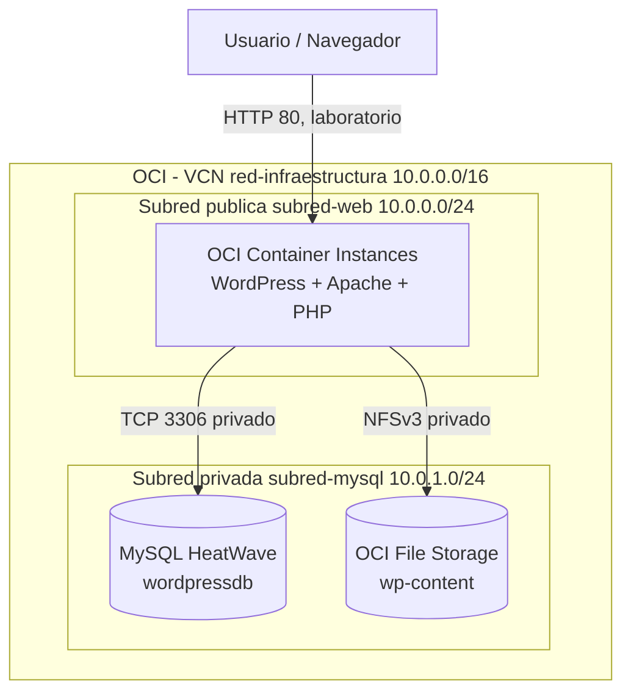

# Taller 7A. Despliegue de WordPress funcional en OCI Container Instances con MySQL HeatWave y File Storage

**Asignatura:** Infraestructura y Cloud Computing  
**Nivel:** último semestre de Ingeniería de Software  
**Modalidad:** práctica individual en Oracle Cloud Infrastructure (OCI)  
**Duración:** abierta; depende del aprovisionamiento y de las pruebas  
**Entorno:** consola web OCI + OCI Cloud Shell + navegador  
**Versión:** 17 de noviembre de 2026

> **Alcance del laboratorio.** Se implementará un WordPress accesible desde Internet, con capacidad para crear páginas, publicar entradas, instalar temas y plugins y cargar imágenes. WordPress se ejecutará en **OCI Container Instances**, los datos relacionales residirán en **MySQL HeatWave** y los archivos modificables de `wp-content` en **OCI File Storage (FSS)**. **No se usa Docker Desktop, OCI Bastion, una VM Compute ni un túnel SSH.** La exposición inicial por HTTP es únicamente didáctica; un sitio real exige dominio, HTTPS, backups y endurecimiento de seguridad.

## Índice de navegación

- [Objetivo, arquitectura y requisitos](#objetivo-y-arquitectura)
- **[Fase 1. Red y base de datos administrada](#fase-1)**
  - [Paso 1.1. Verificar los recursos existentes](#paso-1-1)
  - [Paso 1.2. Configurar la subred privada y las reglas de red](#paso-1-2)
  - [Paso 1.3. Crear MySQL HeatWave](#paso-1-3)
  - [Paso 1.4. Crear la base de datos desde Cloud Shell](#paso-1-4)
- **[Fase 2. Almacenamiento persistente y despliegue de WordPress](#fase-2)**
  - [Paso 2.1. Crear File Storage y su punto de montaje](#paso-2-1)
  - [Paso 2.2. Configurar el acceso NFS del almacenamiento](#paso-2-2)
  - [Paso 2.3. Desplegar WordPress en Container Instances](#paso-2-3)
  - [Paso 2.4. Comprobar el despliegue y los permisos de escritura](#paso-2-4)
- **[Fase 3. Funcionalidad, persistencia y evaluación](#fase-3)**
  - [Paso 3.1. Instalar WordPress desde el navegador](#paso-3-1)
  - [Paso 3.2. Crear contenido, instalar un tema y un plugin](#paso-3-2)
  - [Paso 3.3. Verificar el modelo de datos desde MySQL](#paso-3-3)
  - [Paso 3.4. Reiniciar el contenedor y comprobar la persistencia](#paso-3-4)
  - [Paso 3.5. Entrega, rúbrica y cierre de recursos](#paso-3-5)
- [Problemas frecuentes](#problemas-frecuentes)
- [Referencias oficiales](#referencias)

---

<a id="objetivo-y-arquitectura"></a>
## Objetivo y arquitectura

**Objetivo:** desplegar, configurar y validar una aplicación web de gestión de contenidos sobre servicios cloud administrados, diferenciando la ejecución del contenedor, la persistencia relacional y la persistencia de archivos.

**Resultado verificable:** un sitio WordPress que conserva páginas, publicaciones, plugins, temas y archivos multimedia después de **reiniciar** la instancia de contenedor.



| Recurso | Nombre recomendado | Función |
|---|---|---|
| Compartimento existente | `Infraestructura_y_Cloud` | Organizar los recursos del laboratorio |
| VCN existente | `red-infraestructura`, `10.0.0.0/16` | Comunicación privada entre los servicios |
| Subred pública existente | `subred-web`, `10.0.0.0/24` | WordPress con IP pública |
| Subred privada nueva o reutilizada | `subred-mysql`, `10.0.1.0/24` | Endpoint de MySQL y punto de montaje FSS |
| MySQL DB System | `wordpress-mysql` | Base administrada y persistente |
| Base de datos | `wordpressdb` | Almacena tablas generadas por WordPress |
| File Storage | `fss-wordpress` | Conserva plugins, temas y multimedia |
| Mount Target | `mt-wordpress` | Acceso NFS a FSS desde la VCN |
| Container Instance | `ci-wordpress` | Ejecuta la imagen de WordPress |
| Imagen | `docker.io/library/wordpress:php8.4-apache` | WordPress + PHP 8.4 + Apache |

**Prerrequisito:** [Taller 1: Cuenta y red de Infraestructura y Cloud](https://github.com/adanbeltran/Labs/blob/main/Lab-Despliegue%20Web%20IaaS%20con%20OCI%20Compute/Taller_1_Cuenta_y_Red_Infraestructura_Cloud.md). Se presupone acceso con una cuenta de OCI miembro del grupo **`Administrators` de la tenencia**; no se crean políticas IAM. Ser administrador del dominio de identidad solamente **no** garantiza los permisos de recursos de OCI.

**Cuentas distintas:** la cuenta OCI administra la infraestructura; MySQL tiene su propia cuenta administrativa; WordPress tendrá una cuenta para administrar el sitio. En este laboratorio se reutilizará **una sola cuenta administrativa de MySQL**, sin crear un usuario SQL adicional. Si el formulario permite el nombre `root`, utilizarlo para simplificar; si lo rechaza, usar `adminwp` y reemplazarlo en los comandos. **El administrador de un MySQL gestionado no tiene necesariamente todos los privilegios de `root` en un servidor autoadministrado.**

**Costos:** MySQL HeatWave puede mostrar la plantilla `Always Free` donde esté disponible, pero **Container Instances, File Storage, transferencia y otros componentes pueden ser facturables**. Verificar límites, presupuesto y precio estimado **antes** de crear recursos. No se asegura que el taller sea gratuito.

---

<a id="fase-1"></a>
## Fase 1. Red y base de datos administrada

<a id="paso-1-1"></a>
### Paso 1.1. Verificar los recursos existentes

1. Abrir [OCI Console](https://cloud.oracle.com/) e iniciar sesión con la cuenta administradora utilizada en el Taller 1.
2. Seleccionar la **misma región** en la que existen los recursos. En el compartimento `Infraestructura_y_Cloud`, abrir **Networking → Virtual Cloud Networks → `red-infraestructura`**.
3. Verificar VCN `10.0.0.0/16`, subred `subred-web` `10.0.0.0/24`, Internet Gateway y una ruta de salida a Internet para la subred pública.
4. Confirmar que el compartimento está seleccionado al consultar MySQL HeatWave, File Storage y Container Instances.
5. No modificar ni eliminar recursos de talleres anteriores. Registrar únicamente nombres de recursos y direcciones privadas; no contraseñas.

**Resultado:** red y región identificadas. Si los nombres/CIDR difieren, ajustar los pasos a los recursos **reales**; no crear redes duplicadas.

<a id="paso-1-2"></a>
### Paso 1.2. Configurar la subred privada y las reglas de red

1. En `red-infraestructura`, verificar si ya existe `subred-mysql` `10.0.1.0/24`. Si existe, reutilizarla.
2. Si no existe, crear una **Security List** llamada `seguridad-mysql`, con reglas **stateful** de entrada. Después crear la subred **regional, privada**, `subred-mysql`, CIDR `10.0.1.0/24`, y asociarle esa lista.
3. Seleccionar una tabla de rutas sin salida `0.0.0.0/0` a Internet Gateway. **No asignar IP pública a MySQL ni al Mount Target.**
4. Agregar o verificar las siguientes reglas. Se muestran orígenes de laboratorio; si hay NSG u otras listas restrictivas, configurar las reglas efectivas también allí.

| Recurso destino | Origen | Protocolo / puerto **destino** | Propósito |
|---|---|---|---|
| MySQL en `subred-mysql` | `10.0.0.0/24` | TCP `3306` | Conexión de WordPress desde la subred pública |
| MySQL en `subred-mysql` | `10.0.1.0/24` | TCP `3306` | Administración desde Cloud Shell con red privada |
| Mount Target FSS en `subred-mysql` | `10.0.0.0/24` | TCP y UDP `111` y `2048-2051` | Montaje NFSv3 de OCI Container Instances |
| WordPress en `subred-web` | `0.0.0.0/0` | TCP `80` | Acceso HTTP del navegador para la práctica |

5. En la Security List/NSG de `subred-web`, agregar solo si falta el ingreso TCP `80`. Conservar el egreso hacia MySQL TCP `3306`, hacia FSS TCP/UDP `111` y `2048-2051` y hacia los repositorios que necesitan acceso a Internet. No crear reglas públicas para `3306`, `111` o `2048-2051`.
6. Si se está usando una Security List asociada a toda `subred-mysql`, considerar que estas reglas permiten tráfico a **recursos de esa subred**. Una configuración de producción debe limitarlo con NSG e IP/orígenes específicos.

**Comprobación:** WordPress estará expuesto solo por el puerto web; MySQL y FSS serán accesibles desde las subredes privadas autorizadas. Los filtros de seguridad y la tabla de rutas son controles distintos.

<a id="paso-1-3"></a>
### Paso 1.3. Crear MySQL HeatWave

1. En OCI, abrir **MySQL HeatWave → DB Systems → Create DB system**.
2. Elegir la plantilla **Always Free únicamente si aparece disponible y elegible** en esa cuenta y región. Si no está disponible, seleccionar una opción de desarrollo **solo después de revisar el costo y con autorización del docente**.
3. Configurar:

| Campo | Valor del laboratorio |
|---|---|
| Compartimento | `Infraestructura_y_Cloud` |
| Nombre del DB System | `wordpress-mysql` |
| Cuenta administradora MySQL | `root` **si la consola lo admite**; en otro caso `adminwp` |
| Contraseña | Robusta, personal, no publicada |
| Tipo | `Standalone` |
| VCN | `red-infraestructura` |
| Subred | `subred-mysql` **privada** |
| Versión de MySQL | Versión compatible y disponible que indique OCI para la plantilla |
| Shape | `MySQL.Free` **solo si está autorizado como Always Free** |
| HeatWave cluster | No necesario para WordPress; desactivarlo si el formulario lo permite |
| Copias automáticas | Conservar las opciones impuestas por la plantilla; revisar costos |

4. Confirmar que el endpoint será **privado**, sin IP pública, y que el resumen de precio es aceptable. Crear el DB System y verificar que llegue a **ACTIVE**.
5. Abrir **Endpoints** y registrar la IP privada y el puerto de protocolo clásico MySQL, normalmente `3306`. No publicar claves ni contraseñas.

> **Nota de versión:** en las plantillas `Always Free`, Oracle documenta actualmente copias automáticas habilitadas con retención de **1 día** y la configuración `MySQL.Free` (50 GiB de almacenamiento). No repetir configuraciones antiguas donde las copias estaban desactivadas. El almacenamiento administrado persiste, pero una sola copia de un día no equivale a una estrategia de recuperación integral.

**Evidencia:** DB System `ACTIVE`, subred privada, endpoint y elegibilidad/costo (sin datos sensibles).

<a id="paso-1-4"></a>
### Paso 1.4. Crear la base de datos desde Cloud Shell

1. Abrir **Cloud Shell** desde la consola. En el selector **Network**, seleccionar **Private Network** y asociar la sesión a `red-infraestructura` → `subred-mysql`, en la misma región. La conectividad privada no se obtiene automáticamente con la red predeterminada de Cloud Shell.
2. Comprobar que `mysqlsh` está disponible:

```bash
mysqlsh --version
```

3. Establecer la conexión. Sustituir la IP por el **endpoint real** del DB System. Sustituir `root` por `adminwp` si se usó ese nombre. Introducir la contraseña **cuando se solicite**, nunca en el comando:

```bash
mysqlsh --sqlc -u root -p -h IP_PRIVADA_MYSQL -P 3306
```

4. En el intérprete SQL ejecutar:

```sql
SELECT CURRENT_USER() AS usuario_mysql, VERSION() AS version_mysql;

CREATE DATABASE IF NOT EXISTS wordpressdb
  CHARACTER SET utf8mb4
  COLLATE utf8mb4_unicode_ci;

SHOW DATABASES;

SELECT COUNT(*) AS tablas_antes_de_instalar
FROM information_schema.tables
WHERE table_schema = 'wordpressdb';
```

5. Comprobar que `wordpressdb` existe y que inicialmente no tiene las tablas de WordPress. Salir con `\quit`.

**Si falla la conexión:** verificar el modo **Private Network** de Cloud Shell, región, IP/puerto y regla de ingreso TCP `3306` desde `10.0.1.0/24`. **No habilitar MySQL en Internet** para resolver la incidencia.

**Evidencia:** resultado de `SHOW DATABASES` y número inicial de tablas.

---

<a id="fase-2"></a>
## Fase 2. Almacenamiento persistente y despliegue de WordPress

<a id="paso-2-1"></a>
### Paso 2.1. Crear File Storage y su punto de montaje

1. Abrir **Storage → File Storage → File Systems → Create file system**.
2. Elegir **File system for NFS**, con los valores:

| Elemento | Valor |
|---|---|
| File System | `fss-wordpress` |
| Compartimento | `Infraestructura_y_Cloud` |
| Availability Domain | Preferiblemente el mismo donde se creará Container Instances |
| Cifrado | Oracle-managed (predeterminado) |
| Export path | `/wordpress` |
| Mount Target | `mt-wordpress` (crear si no existe) |
| VCN del Mount Target | `red-infraestructura` |
| Subred del Mount Target | `subred-mysql` (privada) |

3. En las opciones de exportación, mantener el acceso NFS **Read/Write** solo para **origen `10.0.0.0/24`** y activar **Use secure export options / Require privileged source port**. Confirmar que `requirePrivilegedSourcePort = true`. Para inicializar permisos **sin añadir una máquina virtual**, configurar temporalmente *Identity Squash* = **`None`** (no remapear UID/GID), junto con el origen CIDR restringido `10.0.0.0/24` y puertos privilegiados. Esto se usa únicamente en el laboratorio; en producción debe revisarse el modelo de permisos de FSS.
4. Crear el File System, su export y el Mount Target, o reutilizarlos si ya existen. Verificar que el export apunta a `/wordpress` y que el Mount Target tiene **IP privada**.

**Importante:** para el montaje directo FSS desde Container Instances, Oracle exige un export cuyo `requirePrivilegedSourcePort` sea **true**. No confundir el **export path** `/wordpress` (ruta NFS) con el **mount path** en el contenedor, que será `/var/www/html/wp-content`.

<a id="paso-2-2"></a>
### Paso 2.2. Configurar el acceso NFS del almacenamiento

1. Abrir el **Mount Target** y confirmar que está asociado a la subred privada y que tiene ruta de red desde `subred-web`.
2. Revisar la Security List de `subred-mysql`: debe permitir **TCP y UDP `111` y `2048-2051`** con origen `10.0.0.0/24`, según el paso 1.2. Revisar también el egreso desde `subred-web`. No abrir estos puertos a Internet.
3. En el export `/wordpress`, comprobar:

| Parámetro | Valor |
|---|---|
| Source | `10.0.0.0/24` |
| Access | `READ_WRITE` |
| Ports | `Privileged` / `requirePrivilegedSourcePort = true` |
| Protocolo | NFSv3, consumido por Container Instances |
| Identity Squash | `None` **para la inicialización controlada** de permisos en este laboratorio |
| Cifrado del volumen | Opción gestionada por OCI; si la consola permite cifrado NFS en tránsito, verificar su compatibilidad |

4. Identificar los recursos `fss-wordpress`, `mt-wordpress` y el export `/wordpress`; se seleccionarán por nombre en el asistente de despliegue.

> **Permisos de archivos:** el usuario que ejecuta PHP/Apache en la imagen oficial suele ser `www-data` (UID/GID `33`). El export debe permitir escritura efectiva de ese usuario en `wp-content`. **OCI FSS crea normalmente su directorio raíz con propietario `0:0` y permisos `0755`; `READ_WRITE` en NFS no es suficiente por sí solo.** El paso 2.3 inicializará la propiedad de esa ruta en `33:33` mediante el proceso de arranque del contenedor y el paso 2.4 verificará la escritura. No utilizar `chmod 777`.

<a id="paso-2-3"></a>
### Paso 2.3. Desplegar WordPress en Container Instances

1. Abrir **Developer Services → Containers & Artifacts → Container Instances → Create container instance** (la ubicación exacta del menú puede variar).
2. **Basic information:**

| Campo | Valor |
|---|---|
| Name | `ci-wordpress` |
| Compartment | `Infraestructura_y_Cloud` |
| Availability Domain | Compatible con el File Storage creado |
| Shape | Shape flexible disponible; dimensionar inicialmente, p. ej., **1 OCPU y 2 GiB**, sujeto a cuotas/precio |
| Container restart policy | `Always` |

3. **Networking:** elegir `red-infraestructura` → `subred-web`, asignar **IP pública** y verificar que el ingreso TCP `80` está permitido. La conexión a MySQL irá a su **IP privada**, no a `localhost`.
4. **Storage:** en **Actions → Manage file storage**, seleccionar el Mount Target `mt-wordpress`, el export `/wordpress` de `fss-wordpress` y un volumen FSS (por ejemplo, `vol-wp-content`). Seleccionar opciones compatibles y montaje de lectura/escritura. Confirmar que no se eligió `Empty directory` porque ese volumen **no es persistente**.
5. **Containers → Add container**, configurar:

| Campo | Valor |
|---|---|
| Nombre | `wordpress` |
| Image source | External registry → Docker Hub |
| Image | `docker.io/library/wordpress:php8.4-apache` (o el formato separado repositorio/etiqueta que solicite la consola) |
| Credenciales del registry | Ninguna, por tratarse de imagen pública |
| Puerto de servicio | `80` (Apache) |
| Working directory | `/var/www/html` (predeterminado de la imagen) |
| Startup command/arguments | **Configurar inicialización de permisos según el punto 8** |
| Read-only root filesystem | **No activar** para este laboratorio; WordPress necesita inicializar archivos |

6. En **Environment variables**, agregar **cuatro variables**. Los valores de ejemplo no deben copiarse literalmente:

```dotenv
WORDPRESS_DB_HOST=IP_PRIVADA_MYSQL:3306
WORDPRESS_DB_NAME=wordpressdb
WORDPRESS_DB_USER=root
WORDPRESS_DB_PASSWORD=REEMPLAZAR_CON_PASSWORD_MYSQL
```

   Si el administrador MySQL se llamó `adminwp`, escribir `WORDPRESS_DB_USER=adminwp`. La contraseña ingresada en la consola puede quedar visible para usuarios con permisos sobre la configuración del contenedor: **no reutilizar contraseñas personales**. Para producción, integrar secretos gestionados y una cuenta SQL de privilegios mínimos.
7. En **Storage** del contenedor, agregar el volumen `vol-wp-content`:

| Campo | Valor |
|---|---|
| Storage/Volume | `vol-wp-content` |
| Mount path | `/var/www/html/wp-content` |
| Subpath | Vacío, si el export se dedica exclusivamente a este WordPress |
| Read-only | `No` |

8. **Inicializar la propiedad del directorio FSS:** debido a que el directorio raíz nuevo de FSS normalmente pertenece a `root:root`, configurar una sola operación de preparación antes de iniciar Apache. En **Startup options**, sustituir el comando de arranque por estos valores, si la interfaz muestra campos independientes para comando y argumentos:

   **Command** (lista de ejecutable y opción):

   ```json
   ["/bin/sh", "-c"]
   ```

   **Arguments** (un único argumento de shell):

   ```json
   ["chown 33:33 /var/www/html/wp-content && chmod 775 /var/www/html/wp-content && exec docker-entrypoint.sh apache2-foreground"]
   ```

   Esta secuencia se ejecuta como `root` **dentro del contenedor**, cambia únicamente la propiedad del directorio de WordPress montado por NFS y después invoca el arranque oficial de WordPress y Apache. El export debe permitir **Identity Squash: None** y el usuario del proceso inicial debe ser `0` para que `chown` funcione. Si la interfaz no permite editar comando/argumentos como listas, utilizar el formato equivalente que permita la consola, manteniendo exactamente el orden de operaciones. **No copiar los corchetes JSON en un campo que espere solo texto del ejecutable.** No es un mecanismo de endurecimiento para producción: allí se recomienda provisionar previamente los permisos, ejecutar con menos privilegios y utilizar una configuración específica de volumen/`fsGroup`.
9. Revisar antes de crear: red pública para WordPress, DB privado TCP `3306`, FSS con montaje **persistente** en `wp-content`, variables correctas, precio y cuota. Crear la instancia y confirmar que el estado llegue a **ACTIVE**.

**Por qué se monta solo `wp-content`:** conserva plugins, temas y archivos subidos sin confundirlos con el código base de WordPress incluido en la imagen. La imagen oficial inicializa los archivos de WordPress al arrancar. Las actualizaciones del núcleo realizadas **dentro del contenedor**, fuera de `wp-content`, pueden perderse al recrearlo; para mantenerlas, actualizar la imagen y volver a desplegar. Los elementos añadidos al archivo `.htaccess` o a archivos fuera de `wp-content` tampoco quedan cubiertos por este montaje.

<a id="paso-2-4"></a>
### Paso 2.4. Comprobar el despliegue y los permisos de escritura

1. Abrir `ci-wordpress` → **Containers** → `wordpress` → **Actions → View logs**. Comprobar que Apache inicia, que no hay errores NFS ni fallos de conexión a MySQL.
2. Identificar la **IP pública asignada** a Container Instances; abrir `http://IP_PUBLICA_WORDPRESS/`. Debe aparecer el asistente de instalación de WordPress.
3. Finalizar inicialmente la instalación en el paso 3.1 y, antes de avanzar al paso 3.2, comprobar la **escritura real** en `wp-content` intentando cargar una imagen pequeña desde **Medios → Añadir nuevo**. Si funciona, continuar.
4. Si el montaje FSS falla durante la creación del contenedor, verificar `requirePrivilegedSourcePort=true`, export correcto, reglas TCP/UDP NFS y compatibilidad de Availability Domain. Si WordPress abre pero falla la carga de imágenes o pide datos de FTP para plugins, comprobar los logs de **`chown 33:33`** del arranque (paso 2.3), la configuración de `Identity Squash: None` y la escritura del usuario `www-data` sobre el directorio exportado. No asignar permisos universales ni ampliar el export al público.
5. Si el problema es la base de datos, comprobar la IP privada, usuario, contraseña, disponibilidad DB System y TCP `3306` desde `subred-web`. Los logs pueden ayudar, pero **nunca** publicar secretos contenidos en ellos.

**Condición para pasar a la fase 3:** imagen descargada, instancia activa, asistente de WordPress accesible y volumen FSS montado correctamente. La validación de escritura forma parte de los pasos 3.1 y 3.2.

---

<a id="fase-3"></a>
## Fase 3. Funcionalidad, persistencia y evaluación

<a id="paso-3-1"></a>
### Paso 3.1. Instalar WordPress desde el navegador

1. Abrir `http://IP_PUBLICA_WORDPRESS/` y completar el asistente de instalación.
2. Crear un **administrador de WordPress distinto** de la cuenta OCI y de la cuenta de MySQL. Definir sitio **`Laboratorio WordPress OCI`**, correo de prueba y contraseña robusta.
3. Ingresar a `http://IP_PUBLICA_WORDPRESS/wp-admin`.
4. Confirmar **Escritorio**, **Páginas**, **Entradas**, **Apariencia**, **Plugins**, **Usuarios** y **Medios**. Estos menús evidencian que la aplicación está operativa, pero deben verificarse acciones de escritura en el siguiente paso.

<a id="paso-3-2"></a>
### Paso 3.2. Crear contenido, instalar un tema y un plugin

1. **Página:** crear `Página de inicio del laboratorio`, con título, texto descriptivo y al menos dos bloques de contenido. Publicarla y comprobar su URL pública.
2. **Entrada:** crear `Primer artículo desde OCI`, agregar texto y publicarla.
3. **Medios:** cargar una imagen propia o libre de derechos, insertarla en la página y verificar que se visualiza.
4. **Tema:** desde **Apariencia → Temas**, instalar y activar un tema gratuito compatible, diferente del predeterminado. Comprobar un cambio visual.
5. **Plugin:** desde **Plugins → Añadir nuevo**, instalar y activar **un plugin gratuito compatible** (por ejemplo, uno de formularios o un editor visual que muestre compatibilidad con la versión instalada). Configurar al menos una funcionalidad visible.
6. Si un plugin requiere servicios externos, credenciales de pago o licencias, seleccionar otro que pueda probarse íntegramente en la práctica.
7. Confirmar que instalación, activación y archivos funcionan sin pedir datos de FTP. Si hay errores, no afirmar que WordPress es plenamente funcional: revisar FSS y PHP antes de continuar.

**Evidencia mínima:** panel de administración, página publicada, imagen visible, tema activo y plugin operativo, con la URL del sitio.

<a id="paso-3-3"></a>
### Paso 3.3. Verificar el modelo de datos desde MySQL

1. Reabrir Cloud Shell con la red privada seleccionada y conectar a MySQL como en el paso 1.4.
2. Ejecutar las consultas, suponiendo que el prefijo predeterminado es `wp_`:

```sql
SELECT table_name
FROM information_schema.tables
WHERE table_schema = 'wordpressdb'
ORDER BY table_name;

SELECT ID, post_title, post_type, post_status
FROM wordpressdb.wp_posts
WHERE post_type IN ('page', 'post')
ORDER BY ID DESC
LIMIT 20;

SELECT option_name, option_value
FROM wordpressdb.wp_options
WHERE option_name IN ('siteurl', 'home', 'template', 'stylesheet');
```

3. Relacionar los resultados con la página, la entrada y el tema configurado. Si las tablas no comienzan por `wp_`, reemplazar el prefijo.
4. Explicar qué información está almacenada en MySQL y qué archivos se guardan en File Storage. No consultar ni mostrar hashes de contraseñas ni datos privados de usuarios.

<a id="paso-3-4"></a>
### Paso 3.4. Reiniciar el contenedor y comprobar la persistencia

1. Documentar el nombre de la página, el plugin activo y una imagen subida. Guardar la URL e IP pública actuales.
2. Abrir **Container Instances → `ci-wordpress` → Actions → Restart**. **No eliminar** MySQL HeatWave, el export ni File Storage.
3. Esperar el estado `ACTIVE`; verificar nuevamente la **IP pública** de Container Instances (no asumir que es idéntica antes y después del cambio de ciclo de vida).
4. Abrir el sitio y comprobar que permanecen **páginas y entradas** (MySQL) y **plugin, tema e imagen** (FSS). Si el acceso redirige a una dirección antigua por cambio de IP, actualizar primero la URL pública de WordPress de forma controlada desde el panel si es posible, o corregir los valores `home` y `siteurl` en `wordpressdb.wp_options` mediante MySQL Shell; **no realizar reemplazos SQL indiscriminados** en contenido serializado de plugins y editores.
5. Verificar que el plugin continúa activado y que la imagen existe. Explicar por qué un volumen efímero o conservar solo MySQL no habría bastado.

**No es requisito eliminar y recrear toda la instancia.** OCI confirma que al **reiniciar** Container Instances se pierde el almacenamiento efímero; File Storage sigue siendo persistente. La recreación con una **nueva** instancia implica reasociar FSS, variables y red, y gestionar correctamente la URL/IP pública.

<a id="paso-3-5"></a>
### Paso 3.5. Entrega, rúbrica y cierre de recursos

**Entregable:** video **individual**, cámara encendida, de **máximo 10 minutos**, con demostración en vivo de los elementos siguientes. El estudiante debe **comprobar previamente** que el enlace al video permite acceso al docente.

1. VCN y subred privada; MySQL HeatWave `ACTIVE`, sin IP pública.
2. Base `wordpressdb` creada por el estudiante y consultas SQL de verificación.
3. Container Instance activa, IP pública, variables de conexión **sin mostrar contraseñas**, y montaje FSS en `wp-content`.
4. WordPress operativo: página, entrada, tema, imagen y plugin configurado.
5. Resultado después del reinicio: elementos persistentes y explicación de la separación entre DB y FSS.

| Criterio | Nota máxima |
|---|---:|
| Uso correcto de la red, endpoint privado y conectividad MySQL | 1,0 |
| Creación y verificación de la base de datos MySQL HeatWave | 0,8 |
| Configuración de OCI File Storage y montaje persistente | 1,0 |
| Despliegue y funcionalidad de WordPress con tema, plugin e imagen | 1,5 |
| Prueba de persistencia, análisis y claridad del video | 0,7 |
| **Total** | **5,0** |

**Preguntas de análisis para el video:**

1. ¿Por qué MySQL HeatWave no requiere dirección IP pública para atender WordPress?
2. ¿Qué información de WordPress queda en la base y cuál en `wp-content`?
3. ¿Qué ocurriría al reiniciar un contenedor si `wp-content` usara almacenamiento efímero?
4. ¿Por qué los permisos NFS `READ_WRITE` pueden ser insuficientes para instalar plugins?
5. ¿Qué cambiarías para pasar de un laboratorio HTTP con cuenta administrativa MySQL a un servicio de producción?

**Cierre de la práctica:** registrar los recursos creados, comprobar consumo y detener Container Instances cuando ya no se necesite. Detener Container Instances puede pausar el cómputo, pero **no garantiza que MySQL HeatWave o File Storage dejen de generar cargos**. Eliminar únicamente los recursos del laboratorio que no se vayan a reutilizar, previa comprobación de los datos que se perderían. No borrar la VCN del Taller 1 ni bases de datos compartidas.

---

<a id="problemas-frecuentes"></a>
## Problemas frecuentes

| Síntoma | Causa probable | Acción de verificación |
|---|---|---|
| `Error establishing a database connection` | Endpoint, contraseña, usuario o puerto `3306` incorrectos | Revisar DB `ACTIVE`, Cloud Shell SQL, variables de WordPress y reglas privadas |
| La instancia no arranca al montar FSS | Export sin puerto privilegiado, puertos NFS restringidos o Mount Target no alcanzable | Confirmar `requirePrivilegedSourcePort=true`, red TCP/UDP `111` y `2048-2051`, OCID/export correctos |
| Se pueden crear páginas, pero no subir imágenes | `wp-content` no escribible por Apache/PHP | Revisar arranque `chown 33:33`, Identity Squash `None` y permisos `775` sobre el volumen FSS |
| WordPress pide credenciales FTP para instalar plugins | Escritura directa sobre `wp-content` no permitida | Corregir permisos del montaje; no añadir un servidor FTP por defecto |
| El sitio no abre desde Internet | IP, puerto `80`, ruta a Internet o despliegue | Comprobar IP pública, ingreso a `subred-web`, estado y logs |
| Al reiniciar, las páginas están pero los plugins no | `wp-content` no quedó sobre FSS | Confirmar el **mount path** `/var/www/html/wp-content` y volver a probar |
| El sitio redirige a IP anterior | `home`/`siteurl` guardan el dominio o IP inicial | Actualizar ambas URL de forma controlada o utilizar dominio estable/HTTPS |
| Costo inesperado | El servicio o shape no está en Free Tier | Revisar estimación antes del despliegue y detener/eliminar solo recursos propios |

**Límite explícito:** este laboratorio valida creación de contenido, instalación de plugins y persistencia de `wp-content`; **no** demuestra alta disponibilidad, respaldo integral, actualización segura del núcleo, balanceo, dominio ni HTTPS. Plugins concretos pueden exigir extensiones PHP, memoria, correo o recursos de red adicionales; el hecho de que WordPress esté activo no garantiza compatibilidad universal con todos los plugins.

<a id="referencias"></a>
## Referencias oficiales

1. Oracle, [Creating a Container Instance](https://docs.oracle.com/en-us/iaas/Content/container-instances/creating-a-container-instance.htm).
2. Oracle, [Mounting File System Service Resources](https://docs.oracle.com/en-us/iaas/Content/container-instances/creating-mounting-fss.htm) (incluye puertos y requisito de origen privilegiado).
3. Oracle, [Creating a File System](https://docs.oracle.com/en-us/iaas/Content/File/Tasks/create-file-system.htm).
4. Oracle, [Working with NFS Exports and Export Options](https://docs.oracle.com/en-us/iaas/Content/File/Tasks/exportoptions.htm).
5. Oracle, [Creating an Always Free DB System](https://docs.oracle.com/en-us/iaas/mysql-database/doc/creating-always-free-db-system.html).
6. Oracle, [Cloud Shell Networking](https://docs.oracle.com/en-us/iaas/Content/API/Concepts/cloudshellintro_topic-Cloud_Shell_Networking.htm).
7. Oracle, [Restarting a Container Instance](https://docs.oracle.com/en-us/iaas/Content/container-instances/restarting-a-container-instance.htm).
8. Docker, [Imagen oficial de WordPress](https://hub.docker.com/_/wordpress); [código del punto de entrada](https://github.com/docker-library/wordpress/blob/master/docker-entrypoint.sh).

> **Nota docente:** las pantallas de OCI varían por región y fecha. La secuencia prioriza resultados comprobables frente a nombres rígidos de opciones. Si un formulario no ofrece alguna opción, detener ese paso y verificar con las referencias oficiales antes de seleccionar otra configuración.
