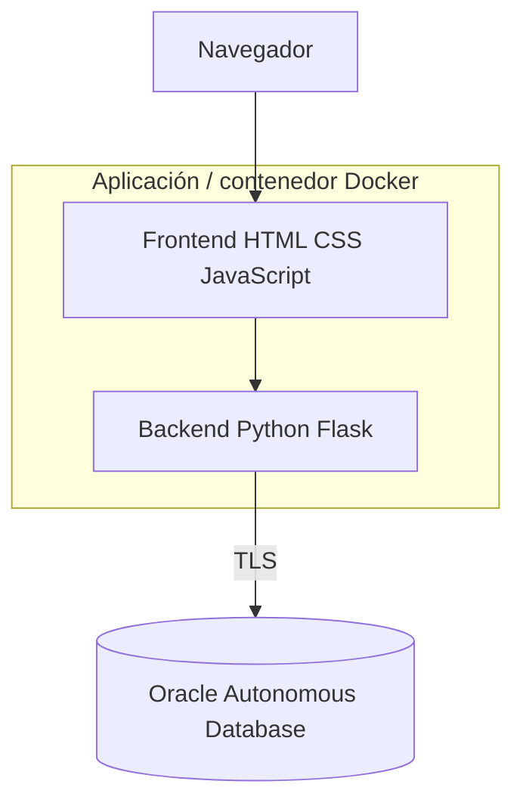
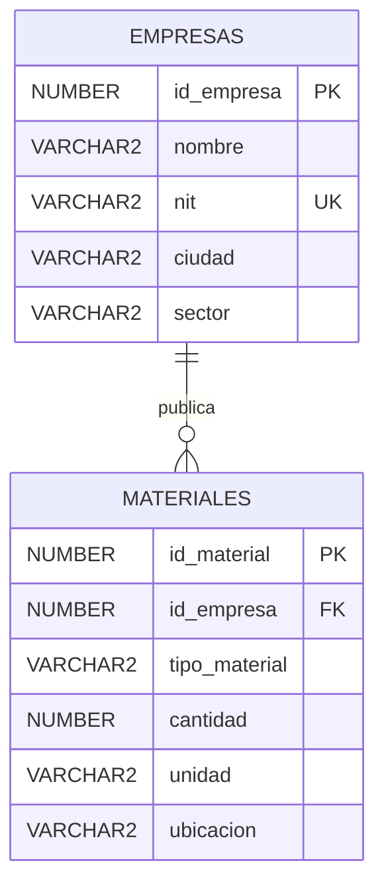

# Taller. Integración de una aplicación web con Oracle Autonomous Database, Python y Docker

**Caso:** EcoRed Circular | **Nivel:** segundo semestre de Ingeniería de Software | **Duración estimada:** 2 horas, con herramientas instaladas.

## Objetivo

Registrar y consultar empresas y materiales desde una aplicación web conectada a Oracle Autonomous Database, probarla desde VS Code y ejecutarla en Docker Desktop.

## Arquitectura



Frontend base: [EcoRed estática](https://github.com/adanbeltran/ecored-estatica). El frontend y backend se ejecutan juntos; la base de datos permanece en OCI. La pantalla de acceso es una simulación: usa datos ficticios.

## Requisitos

- Cuenta OCI con acceso a Autonomous Database.
- Windows, VS Code, Git, Python 3.12, Docker Desktop e Internet.
- Repositorio `ecored-oracle` publicado por el docente.

## Fase 1. Crear la base de datos en Oracle Cloud

### Paso 1.1. Crear la instancia Autonomous Database

1. Ingresa a https://cloud.oracle.com/ y busca **Autonomous Database** (también puede aparecer como Autonomous AI Database).
2. Selecciona **Create Autonomous Database** y el compartimento de trabajo.
3. Configura:

| Parámetro | Valor |
|---|---|
| Display name | EcoRed |
| Database name | ECORED |
| Workload type | Transaction Processing |
| Deployment | Serverless |
| Always Free | Activar si está disponible |
| Administrator | ADMIN |
| Password | Contraseña propia |

Si Always Free no está disponible en la región principal de la cuenta, utiliza una instancia proporcionada por el docente. No contrates recursos de pago sin autorización.

### Paso 1.2. Configurar el acceso a la base de datos

Durante la creación, o posteriormente desde **Network / Edit** o **More actions / Update network access**:

1. Selecciona **Secure access from allowed IPs and VCNs only**.
2. Desactiva **Require mutual TLS (mTLS) authentication**, o habilita TLS sin wallet.
4. Crea la instancia o guarda los cambios. Cuando el estado sea **Available**, verifica que el acceso por TLS esté habilitado y que la lista de acceso esté activa.

> 🎥 **Video de apoyo:** Creación Oracle Autonomous Database.
>
> [Ver video del procedimiento (5 minutos)](https://www.loom.com/share/aa692b26fb5541aa9f5384c66d478923)


### Paso 1.3. Crear el usuario de la aplicación

En la instancia selecciona **Database Actions > SQL**. Ingresa como ADMIN. Ejecuta las siguientes sentencias con **Run Script** (reemplaza la contraseña de ejemplo por una propia, robusta, sin espacios, comillas, # ni $ para facilitar la configuración del taller):

```sql
CREATE USER ecored IDENTIFIED BY "REEMPLAZAR_CONTRASENA";
GRANT CREATE SESSION, CREATE TABLE TO ecored;
ALTER USER ecored QUOTA 20M ON DATA;
```

ADMIN se utiliza solamente para preparar el usuario y sus permisos. ECORED será propietario de sus tablas y el usuario de conexión de Python.

### Paso 1.4. Habilitar el acceso web de ECORED

Sin cerrar la sesión de ADMIN, abre **Administration > Database Users** en Database Actions. Localiza ECORED, edita el usuario, activa **Web Access** y guarda. Verifica que aparezca **REST Enabled** y copia la URL de acceso que aparece en la tarjeta del usuario.

> 🎥 **Video de apoyo:** Creación Usuario Ecored y activar acceso web.
>
> [Ver video del procedimiento (5 minutos)](https://www.loom.com/share/c318aa37f94a4083a7c1ba9152fd332a)


### Paso 1.5. Conectarse como ECORED

Cierra la sesión de ADMIN. Abre la URL copiada e ingresa con el usuario ECORED y su contraseña. Selecciona **SQL** y ejecuta:

```sql
SELECT USER FROM DUAL;
```

El resultado debe ser `ECORED`. No continúes si aparece `ADMIN`.

### Paso 1.6. Crear las tablas del modelo relacional

Una empresa puede publicar varios materiales. Cada publicación pertenece a una empresa.



En la hoja SQL de ECORED, ejecuta el siguiente script con **Run Script**. Las tablas se crearán en su propio esquema.

```sql
CREATE TABLE empresas (
    id_empresa NUMBER GENERATED ALWAYS AS IDENTITY PRIMARY KEY,
    nombre VARCHAR2(120 CHAR) NOT NULL,
    nit VARCHAR2(30 CHAR) NOT NULL UNIQUE,
    ciudad VARCHAR2(80 CHAR) NOT NULL,
    sector VARCHAR2(80 CHAR) NOT NULL
);

CREATE TABLE materiales (
    id_material NUMBER GENERATED ALWAYS AS IDENTITY PRIMARY KEY,
    id_empresa NUMBER NOT NULL,
    tipo_material VARCHAR2(80 CHAR) NOT NULL,
    cantidad NUMBER NOT NULL CHECK (cantidad > 0),
    unidad VARCHAR2(30 CHAR) NOT NULL,
    ubicacion VARCHAR2(120 CHAR) NOT NULL,
    CONSTRAINT fk_material_empresa FOREIGN KEY (id_empresa)
        REFERENCES empresas (id_empresa)
);
```

Las claves primarias identifican los registros. La clave foránea garantiza que cada material pertenezca a una empresa existente. Oracle genera los identificadores automáticamente.

### Paso 1.7. Verificar las tablas

```sql
SELECT * FROM empresas;
SELECT * FROM materiales;
```

Al principio estarán vacías. Comprueba también que pertenecen al usuario conectado:

```sql
SELECT table_name FROM user_tables
WHERE table_name IN ('EMPRESAS', 'MATERIALES');
```

> 🎥 **Video de apoyo:** Login con usuario ECORED y Creación de tablas.
>
> [Ver video del procedimiento (5 minutos)](https://www.loom.com/share/4d4c8fd35ecb4fa19491d29dca44240f)

## Fase 2. Clonar el código fuente

### Paso 2.1. Clonar el repositorio

En PowerShell (terminal de VS Code), una vez publicado por el docente:

```powershell
git clone https://github.com/adanbeltran/ecored-oracle.git
cd ecored-oracle
code .
```

### Paso 2.2. Identificar los archivos

```text
ecored-oracle/
├── frontend/
│   ├── index.html
│   ├── styles.css
│   └── app.js
├── app.py
├── requirements.txt
├── .env.example
├── .gitignore
└── .dockerignore
```

`frontend/` contiene la interfaz; `app.py` contiene el backend; `requirements.txt` contiene las dependencias. No se requiere programar el frontend ni el backend.

## Fase 3. Configurar la conexión a Oracle

### Paso 3.1. Obtener la cadena de conexión

En la instancia de OCI, selecciona **Database connection**. En **TLS authentication**, selecciona **TLS** (no Mutual TLS). Copia la cadena completa del servicio `ecored_low` (o el servicio LOW mostrado por OCI), sin el nombre del alias ni el signo igual que lo separa del descriptor. Debe ser el descriptor que empieza por `(description=`. No necesitas descargar un wallet.

### Paso 3.2. Crear el archivo de variables de entorno

```powershell
Copy-Item .env.example .env
```

Abre `.env` y reemplaza los valores de ejemplo:

```dotenv
DB_USER=ECORED
DB_PASSWORD=REEMPLAZAR
DB_DSN=REEMPLAZAR_CON_CADENA_TLS
```

Pega el descriptor TLS completo en una sola línea y sin comillas externas. Usa la contraseña del usuario ECORED, no la de ADMIN. No publiques `.env` ni lo muestres en el video.

## Fase 4. Ejecutar y probar desde VS Code

### Paso 4.1. Instalar las dependencias

```powershell
py -3.12 -m venv .venv
.\.venv\Scripts\python.exe -m pip install -r requirements.txt
```

### Paso 4.2. Ejecutar el backend

```powershell
.\.venv\Scripts\python.exe app.py
```

Abre http://localhost:5000/api/estado. El resultado esperado es:

```json
{"esquema":"ECORED","estado":"ok"}
```

Si falla, verifica la IP autorizada, el estado Available, la cadena TLS y las credenciales.

### Paso 4.3. Registrar una empresa

Abre http://localhost:5000, utiliza el acceso simulado y registra:

| Campo | Valor |
|---|---|
| Nombre | Reciclar Bogotá |
| NIT | 900123456-1 |
| Ciudad | Bogotá |
| Sector | Reciclaje |

Pulsa **Guardar empresa**.

### Paso 4.4. Registrar un material

En Materiales registra:

| Campo | Valor |
|---|---|
| Empresa | Reciclar Bogotá |
| Tipo de material | Cartón |
| Cantidad | 80 |
| Unidad | kg |
| Ubicación | Bodega principal |

Pulsa **Guardar publicación**.

### Paso 4.5. Verificar la información en Oracle

En Database Actions, ingresa con ECORED y ejecuta:

```sql
SELECT * FROM empresas;
SELECT * FROM materiales;
```

Comprueba la relación entre ambas tablas:

```sql
SELECT e.nombre, m.tipo_material, m.cantidad, m.unidad
FROM empresas e
JOIN materiales m ON e.id_empresa = m.id_empresa;
```

Detén el backend con `Ctrl+C`.

## Fase 5. Construir y ejecutar el contenedor Docker

### Paso 5.1. Crear el Dockerfile

En la carpeta principal crea un archivo `Dockerfile` sin extensión:

```dockerfile
FROM python:3.12-slim
WORKDIR /app
COPY requirements.txt .
RUN pip install --no-cache-dir -r requirements.txt
COPY app.py .
COPY frontend/ frontend/
EXPOSE 5000
CMD ["python", "app.py"]
```

`FROM` selecciona Python, `WORKDIR` establece la carpeta de trabajo, `COPY` copia archivos, `RUN` instala dependencias, `EXPOSE` documenta el puerto y `CMD` inicia el backend.

### Paso 5.2. Construir la imagen

Abre Docker Desktop y ejecuta en la terminal:

```powershell
docker build -t ecored-oracle:v1 .
docker images
```

En **Images** comprueba que aparezca `ecored-oracle:v1`.

### Paso 5.3. Ejecutar el contenedor

```powershell
docker run -d --name ecored-container -p 127.0.0.1:8080:5000 --env-file .env ecored-oracle:v1
```

`-p` conecta el puerto 8080 local con el 5000 del contenedor. `--env-file` proporciona las variables de conexión sin incorporarlas a la imagen. En Docker Desktop selecciona **Containers** y comprueba el estado del contenedor.

### Paso 5.4. Probar la aplicación

Abre http://localhost:8080. Ingresa con el acceso simulado, comprueba los registros existentes y registra otra empresa y otro material. Verifica los nuevos datos en Oracle con las consultas del paso 4.5.

### Paso 5.5. Comprobar la persistencia de los datos

```powershell
docker stop ecored-container
docker start ecored-container
```

Vuelve a abrir http://localhost:8080 y comprueba que los registros continúan disponibles.

## Reto y entregable

Graba un video de máximo cinco minutos mostrando las tablas, la prueba desde VS Code, el Dockerfile, la imagen y el contenedor en Docker Desktop, y el registro de una nueva empresa y un material con su verificación en Oracle. Explica por qué los registros permanecen al reiniciar el contenedor y cómo se relacionan las tablas. No muestres credenciales.

## Referencias

- [Crear una instancia Autonomous Database](https://docs.oracle.com/en-us/iaas/autonomous-database-serverless/doc/autonomous-provision.html)
- [Configurar acceso TLS](https://docs.oracle.com/en-us/iaas/autonomous-database-serverless/doc/support-tls-mtls-authentication.html)
- [Conectar Python sin wallet](https://docs.oracle.com/en-us/iaas/autonomous-database-serverless/doc/connecting-python-tls.html)
- [Crear usuarios de base de datos](https://docs.oracle.com/en-us/iaas/autonomous-database-serverless/doc/manage-users-create.html)
- [Habilitar Database Actions para usuarios de base de datos](https://docs.oracle.com/en/cloud/paas/autonomous-database/serverless/adbsb/connect-database-actions.html)
